<h1 align="center">autoJetsonBot</h1>

<p align="center">
  <b>An autonomous ROS 2 mobile robot on a Jetson Xavier NX, with a Gazebo digital twin that runs the same stack.</b><br>
  SLAM · AMCL + Nav2 · EKF wheel and IMU fusion · ESP32-S3 real-time controller · Web dashboard · Docker
</p>

<p align="center">
  
  
  
  
  
  
</p>

<p align="center">
  <a href="https://youtu.be/JTg8ff2hSGM">
    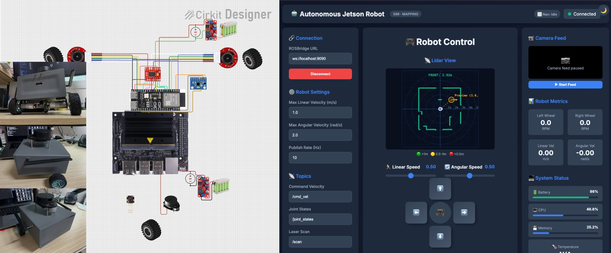
  </a>
  <br>
  <em>The robot · its first wiring diagram · the web dashboard. Click for the demo video.</em>
</p>

<p align="center">
  <a href="docs/architecture/SYSTEM_ARCHITECTURE.md"><b>Architecture</b></a> ·
  <a href="docs/architecture/HARDWARE.md"><b>Hardware</b></a> ·
  <a href="docs/experiments/RESULTS.md"><b>Experiments and Results</b></a> ·
  <a href="docs/guides/GETTING_STARTED.md"><b>Getting Started</b></a> ·
  <a href="https://youtu.be/JTg8ff2hSGM"><b>Demo Video</b></a>
</p>

---

## The Idea

Build the robot twice, once in Gazebo and once in hardware, and run **one ROS 2 stack** on both. The simulated robot uses the real one's measured dimensions and publishes the same topics and frames, so mapping, localization, navigation and the dashboard are developed in simulation and then run on the Jetson with only the drivers swapped. One script, `robot.sh`, builds and launches either mode in Docker.

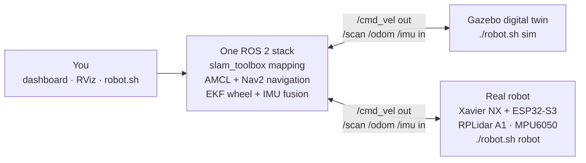

## Highlights

- **ROS 2 workspace:** Eight `jetson_bot_*` packages: bringup, description, diffdrive bridge, IMU, SLAM, navigation, web GUI and detection.
- **Digital twin:** A URDF built from a hand-measured audit of the chassis, REP 120 frames (`map → odom → base_footprint → base_link`), and a Gazebo lab world.
- **Real-time split:** An ESP32-S3 drives the motors and reads the encoders and IMU. A Python serial bridge on the Jetson turns that into odometry, joint states and IMU data at 50 Hz, and a 500 ms failsafe stops the motors if commands stop.
- **Sensor fusion:** A Madgwick filter and a `robot_localization` EKF fuse wheels and IMU into `/odom_filtered`, which Nav2 uses.
- **Mapping and navigation:** `slam_toolbox` in async mode, AMCL, and Nav2 with the DWB planner, tuned costmaps and recovery behaviours.
- **Web dashboard:** Modular ES6 front end over rosbridge, with teleop, a stop button, live lidar, map and path overlay, wheel RPM and system metrics.
- **Docker workflow:** `robot.sh` builds the image, compiles the workspace and launches simulation, hardware or navigation mode. Humble is the default, and Foxy is still available.
- **Measured bring-up:** The Humble port runs on the Xavier NX, and the lidar, telemetry, encoders, IMU and camera were each tested on the robot, with numbers in [RESULTS.md](docs/experiments/RESULTS.md).

## The Robot

<p align="center">
  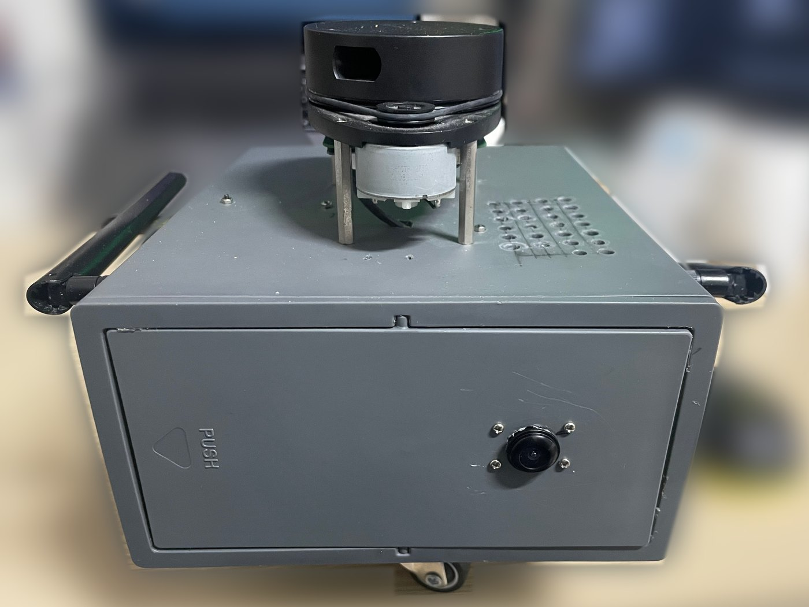
  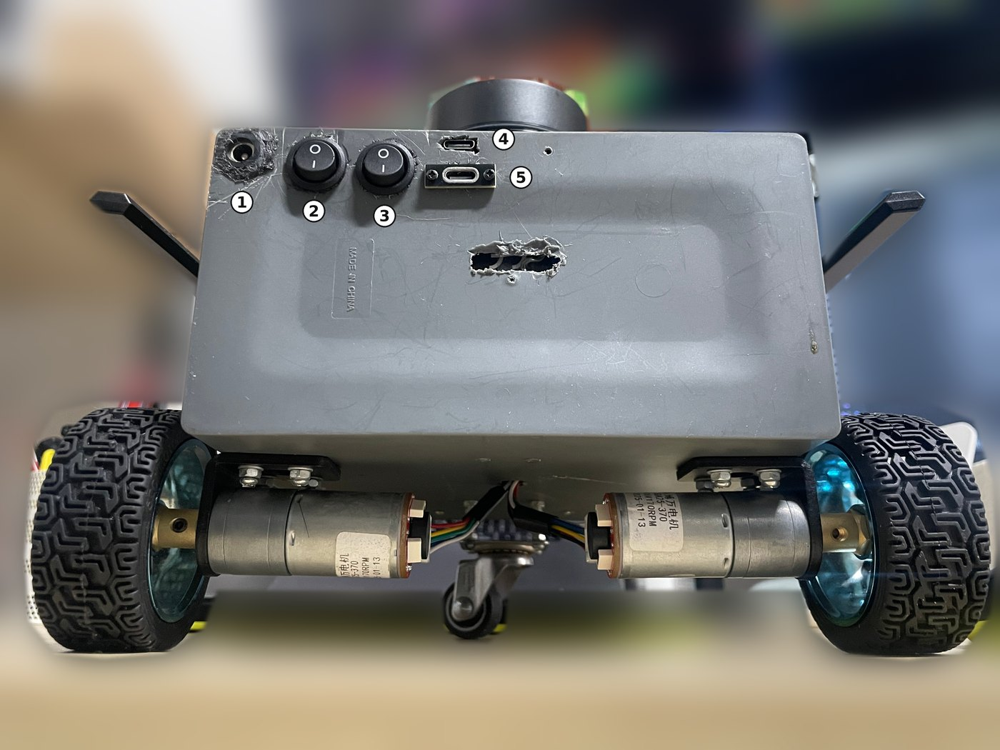
  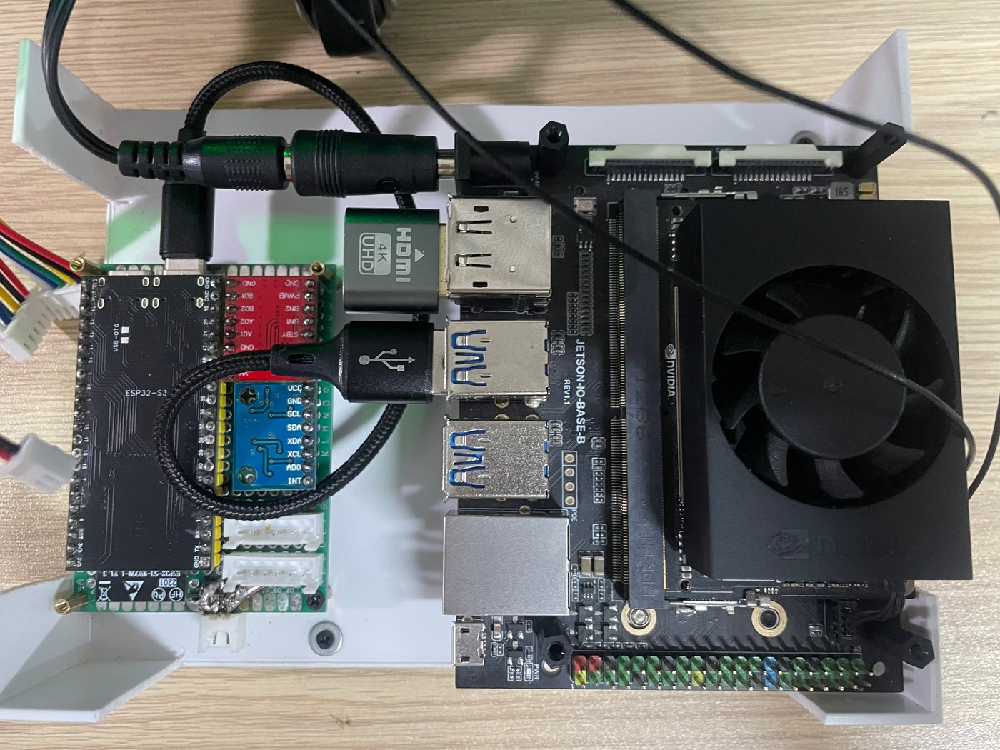
  <br>
  <em>Front with the camera · rear with the power controls, numbered in <a href="docs/architecture/HARDWARE.md#power">HARDWARE.md</a> · the tray with the motor board and the Jetson</em>
</p>

| Part | Details |
| :--- | :--- |
| **Computer** | NVIDIA Jetson Xavier NX, 8 GB, on a Waveshare carrier board, running ROS 2 Humble in Docker |
| **Real-time controller** | ESP32-S3 with a TB6612FNG motor driver, on the Jetson's USB |
| **Drive** | Differential drive, 2 × JGA25-370 gear motors with Hall encoders, 68 mm wheels, swivel caster at the front |
| **Sensors** | RPLidar A1 (360° lidar), MPU6050 (6-axis IMU), IMX219 CSI camera with a wide-angle lens |
| **Power** | A battery for the Jetson and another for the motors, each with its own switch and USB-C charging, and a DC jack for the Jetson's mains adapter |
| **Size** | 19.4 × 17.8 × 9.7 cm chassis, wheel separation 0.212 m |

Parts, wiring, pin map and measurements are in [HARDWARE.md](docs/architecture/HARDWARE.md).

## How It Works

On the robot, the Jetson runs ROS 2 in a container and talks to the ESP32-S3 over USB serial: wheel speeds go down, and encoder counts and IMU readings come back 50 times a second. The bridge turns the counts into odometry and passes the IMU lines on, the EKF fuses both, and SLAM or AMCL places the robot on the map for Nav2.

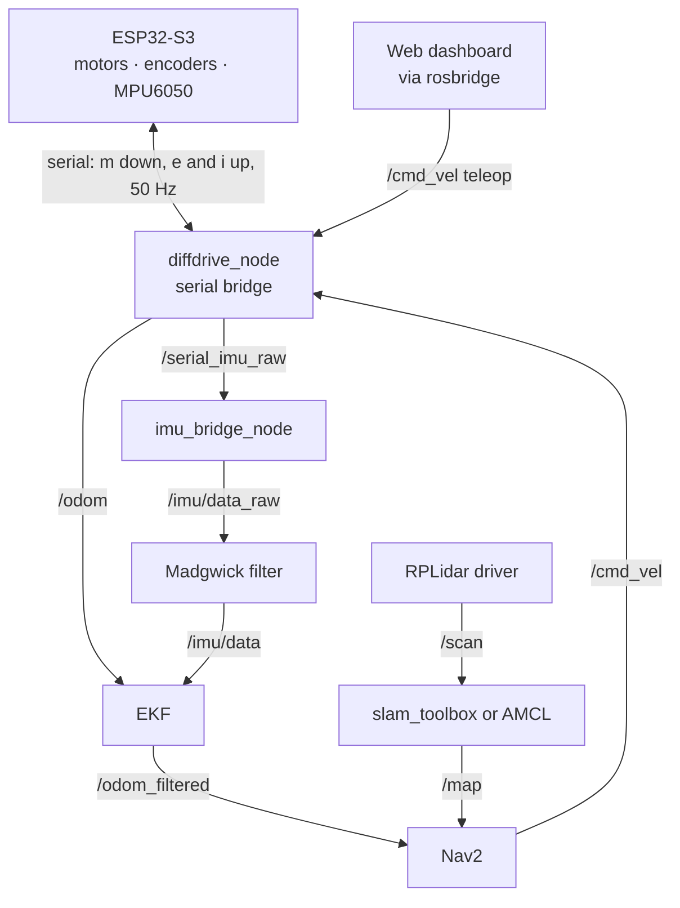

The full node graph, TF tree, serial protocol and launch modes are in [SYSTEM_ARCHITECTURE.md](docs/architecture/SYSTEM_ARCHITECTURE.md).

## Results

| Simulation: driving in the Gazebo lab (June 2026, Foxy) | Simulation: Nav2 costmap (June 2026, Foxy) |
| :---: | :---: |
| 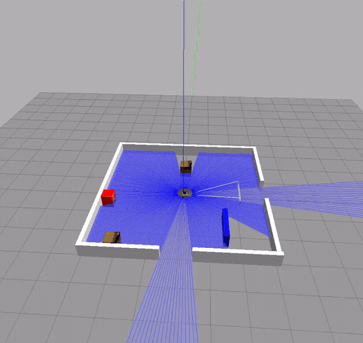 | 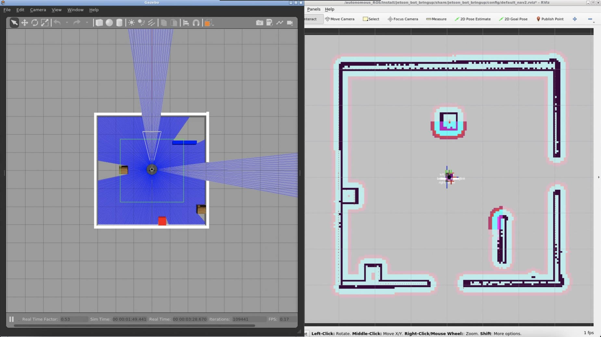 |
| **Real robot: map from the lidar** | **Web dashboard** |
| 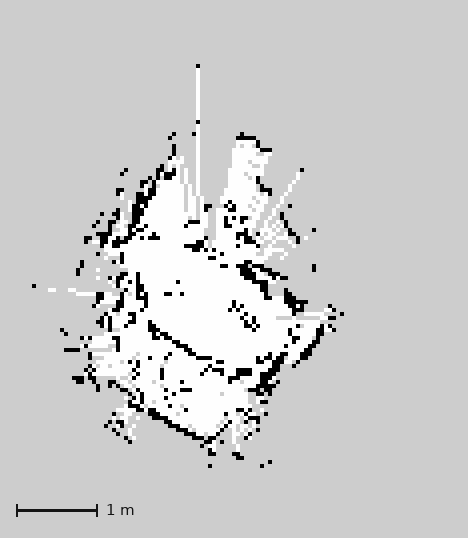 | 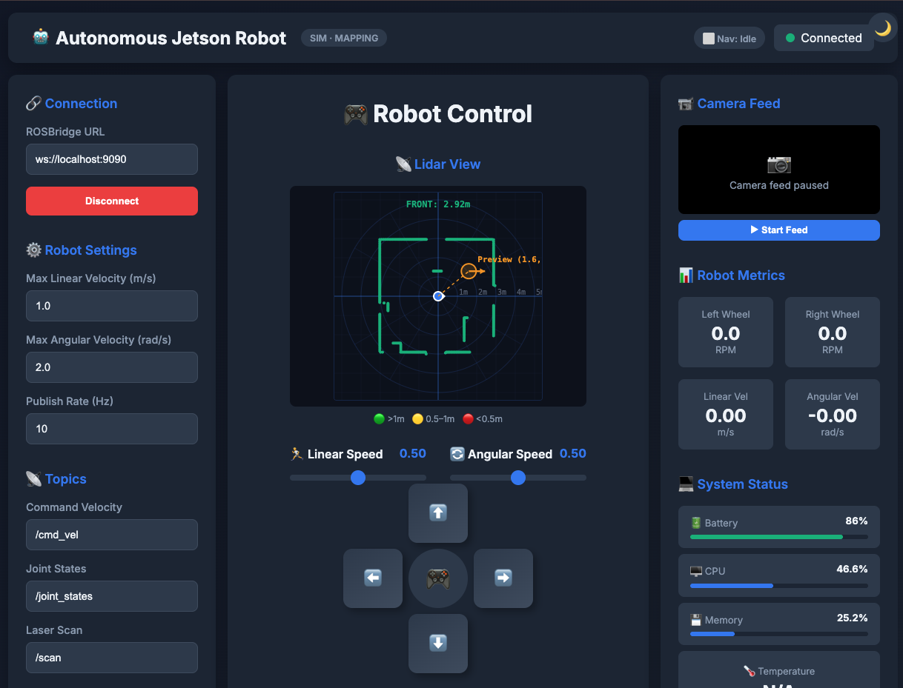 |

<p align="center">
  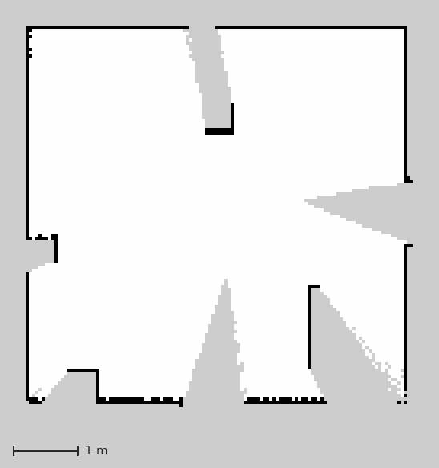
  <br>
  <em>SLAM map built in Gazebo under Humble (November 2026)</em>
</p>

- **Simulation:** Mapping and autonomous goals work with EKF-fused odometry, rechecked under Humble in November 2026 (map above).
- **Robot:** Under Humble on the Xavier NX, the lidar runs at 6.46 Hz and `slam_toolbox` builds maps. Encoders and IMU stream at 50 Hz and the full TF chain is up. On 2026-11-24 the robot mapped its room and reached its first Nav2 goal, stopping 6.5 cm short of a goal 1.0 m ahead, inside Nav2's 10 cm tolerance.
- **Motors:** A rebuilt closed-loop motor firmware holds requested wheel speeds from 0.02 to 0.25 m/s within 1 to 2%, with the wheels lifted. The encoders count 1,497 per wheel turn, and the motors stop 0.75 s after commands stop. Driven through ROS, `/odom` matches the commands within 3%. On the floor, with feed-forward set there, both wheels hold requests within 0.003 m/s.
- **Camera:** The CSI camera reaches ROS at 15 fps, 820×616 over its full field of view, about 21 ms after capture with the whole stack running. The container has no Argus, so the Jetson host reads the camera, corrects its colour from a measurement on white paper and has the Jetson's JPEG engine encode it, which takes a third of a core where encoding in software took three quarters. A node in the container publishes the stream. White paper comes out neutral grey to within about 3% across the frame, where the camera alone gave it a magenta cast that turned pink at the edges. The lens is locked and has a provisional calibration, published as `camera_info` with every frame, and the camera's measured position and tilt are in the URDF, ready for camera-based docking.

All twenty-one experiments, with method and numbers, are in [RESULTS.md](docs/experiments/RESULTS.md).

## Project Status

| Capability | In simulation | On the robot |
| :--- | :--- | :--- |
| Mapping (`slam_toolbox`) | ✅ Working | ✅ Room mapped on 2026-11-24, walls within 2 to 4 cm of straight lines on 5 cm cells |
| Localization and Nav2 goals | ✅ Working | ✅ First goal on 2026-11-24: 1.0 m ahead, stopped 6.5 cm short, inside the 10 cm tolerance, with no recoveries |
| Wheel odometry | ✅ Working | ✅ 31.1 cm and +85.5° on `/odom` for 30 cm and 86° driven on the floor, within 1° of the gyro |
| IMU and EKF fusion | ✅ Working | ✅ Heading follows the wheels and gyro and holds at rest, and with Nav2 running its distance follows the wheels within 0.1% |
| Motor control | ✅ Working | ✅ Closed-loop speed within 0.003 m/s on the floor |
| Web dashboard | ✅ Working | ✅ Teleop, lidar and telemetry used on the robot under Foxy |
| Camera | ✅ Simulated camera, 640×480 at 10 Hz | ✅ CSI camera on `/camera/image_raw` at 15 fps, shown in the dashboard, with a provisional lens calibration on `/camera/camera_info` |

The live status board, with every open problem, is [PROJECT_ANALYSIS.md](docs/PROJECT_ANALYSIS.md).

## Quick Start

```bash
git clone https://github.com/jakhon37/autoJetsonBot.git
cd autoJetsonBot
./robot.sh image   # build the ROS 2 Humble Docker image
./robot.sh build   # build the jetson_bot_* workspace
./robot.sh sim     # Gazebo + SLAM + dashboard (amd64 host)
./robot.sh robot   # on the Jetson, with the robot's USB devices plugged in
```

Open the dashboard at <http://localhost:8000>, and RViz and Gazebo over VNC at `localhost:5900`. More in [GETTING_STARTED.md](docs/guides/GETTING_STARTED.md), [MAPPING_AND_NAVIGATION.md](docs/guides/MAPPING_AND_NAVIGATION.md) and [HARDWARE_BRINGUP.md](docs/guides/HARDWARE_BRINGUP.md).

## Repository Layout

```text
autoJetsonBot/
├── robot.sh                    # One CLI for Docker, build, launch and status
├── Dockerfile.humble           # ROS 2 Humble image (default)
├── Dockerfile.foxy             # ROS 2 Foxy image
├── docker-compose.yaml
├── src/                        # ROS 2 workspace
│   ├── jetson_bot_bringup/     # Launch files, worlds, unified_robot_config.yaml, EKF config
│   ├── jetson_bot_description/ # URDF/xacro model of the robot
│   ├── jetson_bot_camera/      # Publishes the camera's MJPEG stream as ROS images
│   ├── jetson_bot_diffdrive/   # Python serial bridge to the ESP32-S3
│   ├── jetson_bot_imu/         # Turns the ESP32's IMU lines into sensor_msgs/Imu
│   ├── jetson_bot_slam/        # slam_toolbox configuration
│   ├── jetson_bot_navigation/  # Nav2 configuration
│   ├── jetson_bot_gui/         # Web dashboard and telemetry
│   └── jetson_bot_detection/   # Object detection demo, not wired to a camera yet
├── tools/                      # Host-side helpers, such as the CSI camera server
├── maps/                       # Saved occupancy grids (.pgm + .yaml)
├── docs/                       # Architecture, guides, results, plans, project records
├── assets/                     # Photos, screenshots, results figures, wiring, reference sheets
└── test_suite/                 # Integration and hardware tests (run_tests.py)
```

## Documentation

| Document | What's in it |
| :--- | :--- |
| [System architecture](docs/architecture/SYSTEM_ARCHITECTURE.md) | Main idea, node graph, TF tree, serial protocol, launch modes |
| [Hardware](docs/architecture/HARDWARE.md) | Parts, connections, pin map, physical parameters |
| [Experiments and results](docs/experiments/RESULTS.md) | What was tested in simulation and on the robot, with figures |
| [Getting started](docs/guides/GETTING_STARTED.md) | Docker setup, commands, configuration |
| [Mapping and navigation](docs/guides/MAPPING_AND_NAVIGATION.md) | From a new map to autonomous goals |
| [Hardware bring-up](docs/guides/HARDWARE_BRINGUP.md) | Connecting and checking the real robot |
| [Lessons learned](docs/LESSONS_LEARNED.md) | Pitfalls hit along the way and their fixes |
| [All docs](docs/README.md) | Design docs, plans, status board, session log |

## Related Repositories

| Repository | Role |
| :--- | :--- |
| [MOTOR-ESP32S3](https://github.com/jakhon37/MOTOR-ESP32S3) | ESP32-S3 motor, encoder and IMU firmware |
| [myESP32CAM-BLACKBOX](https://github.com/jakhon37/myESP32CAM-BLACKBOX) | Firmware for the ESP32-CAM, the robot's Wi-Fi camera until November 2026 |
| [autonomous_ROS](https://github.com/jakhon37/autonomous_ROS) | The earlier project this one grew from |

## License

MIT. See [LICENSE](LICENSE). For questions, contact jakhon37@gmail.com.
