<h1 align="center">autoJetsonBot</h1>

<p align="center">
  <b>An autonomous ROS 2 mobile robot on a Jetson Xavier NX, with a Gazebo digital twin that runs the same stack.</b><br>
  SLAM · AMCL + Nav2 · EKF wheel and IMU fusion · ESP32-S3 real-time controller · Web dashboard · Docker
</p>

<p align="center">
  
  
  
  
  
  
</p>

<p align="center">
  <a href="https://youtu.be/JTg8ff2hSGM">
    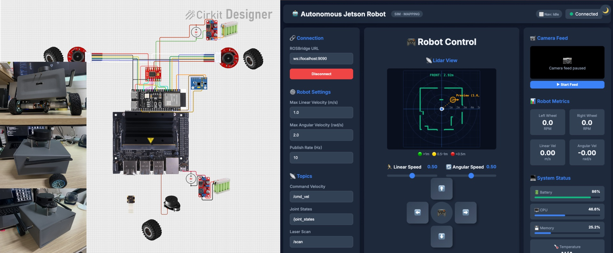
  </a>
  <br>
  <em>The robot · its first wiring diagram · the web dashboard. Click for the demo video.</em>
</p>

<p align="center">
  <a href="docs/architecture/SYSTEM_ARCHITECTURE.md"><b>Architecture</b></a> ·
  <a href="docs/architecture/HARDWARE.md"><b>Hardware</b></a> ·
  <a href="docs/experiments/RESULTS.md"><b>Experiments and Results</b></a> ·
  <a href="docs/guides/GETTING_STARTED.md"><b>Getting Started</b></a> ·
  <a href="https://youtu.be/JTg8ff2hSGM"><b>Demo Video</b></a>
</p>

---

## The Idea

Build the robot twice, once in Gazebo and once in hardware, and run **one ROS 2 stack** on both. The simulated robot uses the real one's measured dimensions and publishes the same topics and frames, so mapping, localization, navigation and the dashboard are developed in simulation and then run on the Jetson with only the drivers swapped. One script, `robot.sh`, builds and launches either mode in Docker.

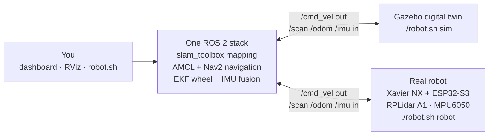

## Highlights

- **ROS 2 workspace:** Eight `jetson_bot_*` packages: bringup, description, diffdrive bridge, IMU, SLAM, navigation, web GUI and detection.
- **Digital twin:** A URDF built from a hand-measured audit of the chassis, REP 120 frames (`map → odom → base_footprint → base_link`), and a Gazebo lab world.
- **Real-time split:** An ESP32-S3 drives the motors and reads the encoders and IMU. A Python serial bridge on the Jetson turns that into odometry, joint states and IMU data at 50 Hz, and a 500 ms failsafe stops the motors if commands stop.
- **Sensor fusion:** A Madgwick filter and a `robot_localization` EKF fuse wheels and IMU into `/odom_filtered`, which Nav2 uses.
- **Mapping and navigation:** `slam_toolbox` in async mode, AMCL, and Nav2 with the DWB planner, tuned costmaps and recovery behaviours.
- **Web dashboard:** Modular ES6 front end over rosbridge, with teleop, a stop button, live lidar, map and path overlay, wheel RPM and system metrics.
- **Docker workflow:** `robot.sh` builds the image, compiles the workspace and launches simulation, hardware or navigation mode. Humble is the default, and Foxy is still available.
- **Measured bring-up:** The Humble port runs on the Xavier NX, and the lidar, telemetry, encoders, IMU and Wi-Fi camera were each tested on the robot, with numbers in [RESULTS.md](docs/experiments/RESULTS.md).

## The Robot

<p align="center">
  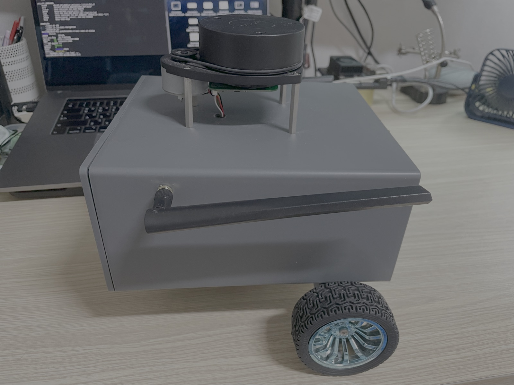
  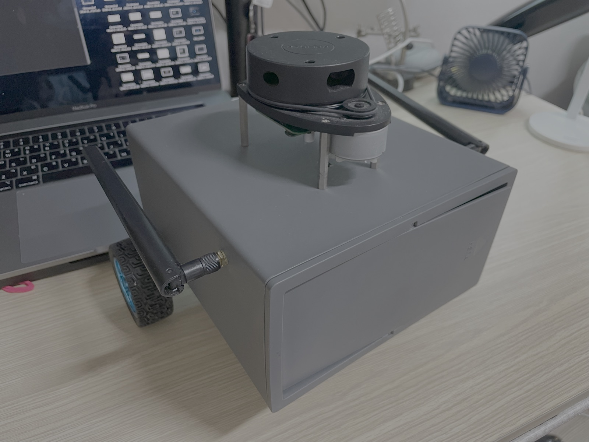
  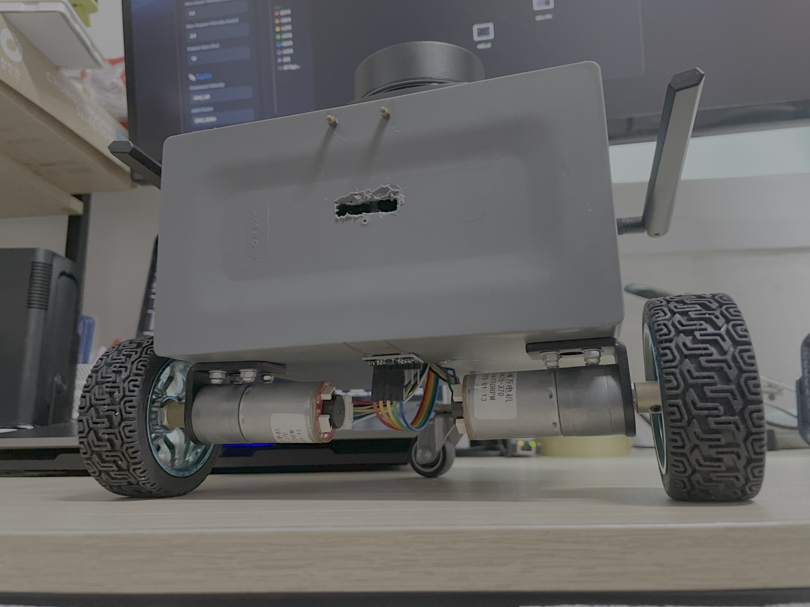
</p>

| Part | Details |
| :--- | :--- |
| **Computer** | NVIDIA Jetson Xavier NX Developer Kit, 8 GB, running ROS 2 Humble in Docker |
| **Real-time controller** | ESP32-S3 with a TB6612FNG motor driver, on the Jetson's USB |
| **Drive** | Differential drive, 2 × JGA25-370 gear motors with Hall encoders, 68 mm wheels, front caster |
| **Sensors** | RPLidar A1 (360° lidar), MPU6050 (6-axis IMU), ESP32-CAM (Wi-Fi camera) |
| **Size** | 19.4 × 17.8 × 9.7 cm chassis, wheel separation 0.212 m |

Parts, wiring, pin map and measurements are in [HARDWARE.md](docs/architecture/HARDWARE.md).

## How It Works

On the robot, the Jetson runs ROS 2 in a container and talks to the ESP32-S3 over USB serial: wheel speeds go down, and encoder counts and IMU readings come back 50 times a second. The bridge turns the counts into odometry and passes the IMU lines on, the EKF fuses both, and SLAM or AMCL places the robot on the map for Nav2.

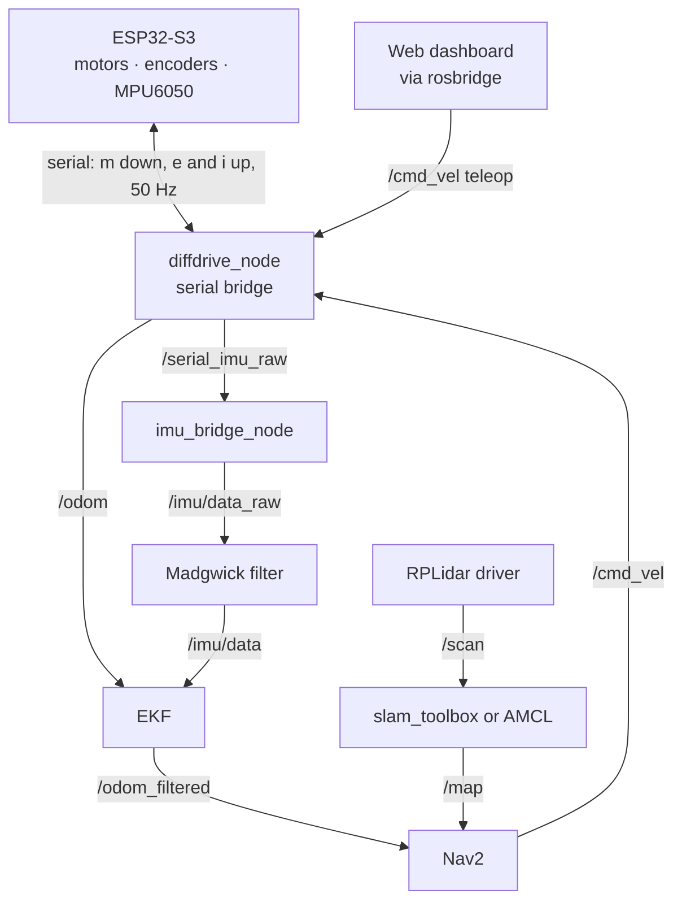

The full node graph, TF tree, serial protocol and launch modes are in [SYSTEM_ARCHITECTURE.md](docs/architecture/SYSTEM_ARCHITECTURE.md).

## Results

| Simulation: driving in the Gazebo lab (June 2026, Foxy) | Simulation: Nav2 costmap (June 2026, Foxy) |
| :---: | :---: |
| 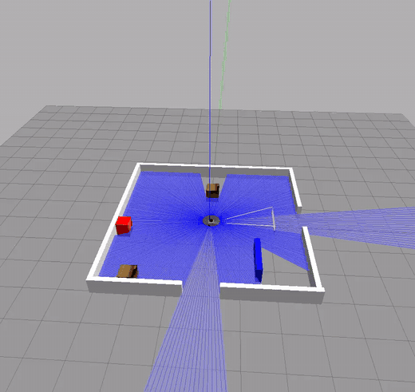 | 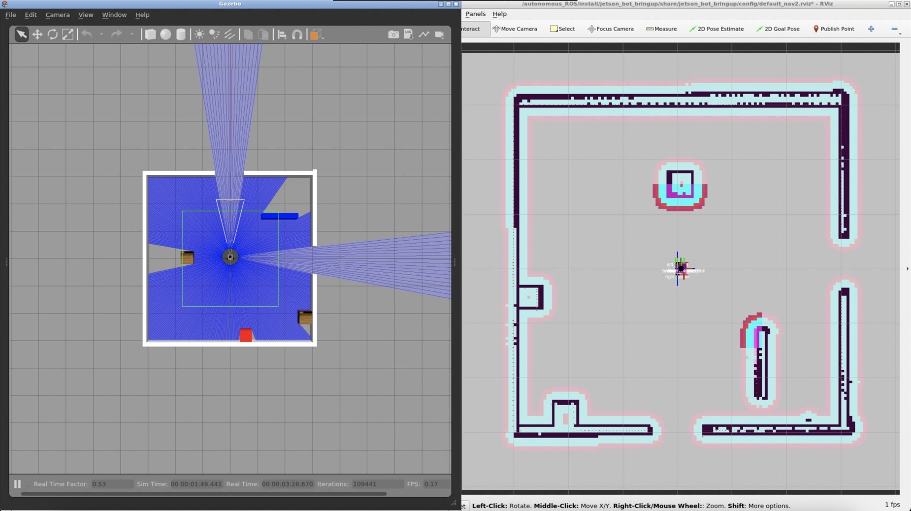 |
| **Real robot: map from the lidar** | **Web dashboard** |
| 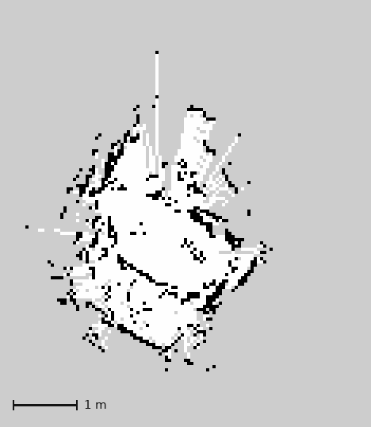 | 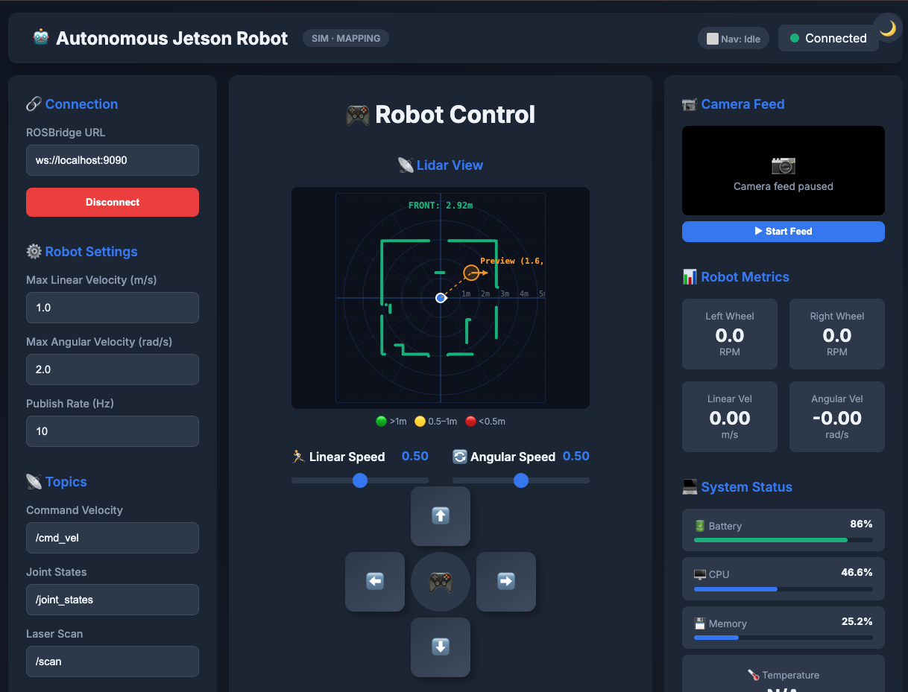 |

<p align="center">
  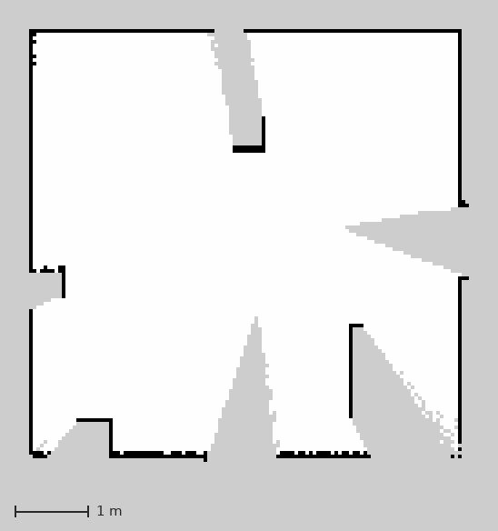
  <br>
  <em>SLAM map built in Gazebo under Humble (November 2026)</em>
</p>

- **Simulation:** Mapping and autonomous goals work with EKF-fused odometry, rechecked under Humble in November 2026 (map above).
- **Robot:** Under Humble on the Xavier NX, the lidar runs at 6.46 Hz and `slam_toolbox` builds maps. Encoders and IMU stream at 50 Hz and the full TF chain is up.
- **Motors:** A rebuilt closed-loop motor firmware holds requested wheel speeds from 0.02 to 0.25 m/s within 1 to 2%, with the wheels lifted. The encoders count 1,497 per wheel turn, and the motors stop 0.75 s after commands stop. Driven through ROS, `/odom` matches the commands within 3%. On the floor, with feed-forward set there, both wheels hold requests within 0.003 m/s.
- **Camera:** The ESP32-CAM streams 320×240 at about 10 fps over Wi-Fi. Firmware changes cut its idle ping from about 300 ms to 13 ms and let it rejoin Wi-Fi on its own.

All eleven experiments, with method and numbers, are in [RESULTS.md](docs/experiments/RESULTS.md).

## Project Status

| Capability | In simulation | On the robot |
| :--- | :--- | :--- |
| Mapping (`slam_toolbox`) | ✅ Working | ✅ Maps built from the real lidar |
| Localization and Nav2 goals | ✅ Working | ⏳ Not run yet, waiting for calibrated odometry |
| Wheel odometry | ✅ Working | ✅ 30.9 and 31.3 cm on `/odom` for 30 cm driven on the floor |
| IMU and EKF fusion | ✅ Working | ⚠️ Gyro offsets corrected in firmware, EKF settings fixed after floor drives, recheck pending |
| Motor control | ✅ Working | ✅ Closed-loop speed within 0.003 m/s on the floor |
| Web dashboard | ✅ Working | ✅ Teleop, lidar and telemetry used on the robot under Foxy |
| Camera | ✅ Simulated camera, 640×480 at 10 Hz | ⚠️ Streams over Wi-Fi, not yet a ROS topic |

The live status board, with every open problem, is [PROJECT_ANALYSIS.md](docs/PROJECT_ANALYSIS.md).

## Quick Start

```bash
git clone https://github.com/jakhon37/autoJetsonBot.git
cd autoJetsonBot
./robot.sh image   # build the ROS 2 Humble Docker image
./robot.sh build   # build the jetson_bot_* workspace
./robot.sh sim     # Gazebo + SLAM + dashboard (amd64 host)
./robot.sh robot   # on the Jetson, with the robot's USB devices plugged in
```

Open the dashboard at <http://localhost:8000>, and RViz and Gazebo over VNC at `localhost:5900`. More in [GETTING_STARTED.md](docs/guides/GETTING_STARTED.md), [MAPPING_AND_NAVIGATION.md](docs/guides/MAPPING_AND_NAVIGATION.md) and [HARDWARE_BRINGUP.md](docs/guides/HARDWARE_BRINGUP.md).

## Repository Layout

```text
autoJetsonBot/
├── robot.sh                    # One CLI for Docker, build, launch and status
├── Dockerfile.humble           # ROS 2 Humble image (default)
├── Dockerfile.foxy             # ROS 2 Foxy image
├── docker-compose.yaml
├── src/                        # ROS 2 workspace
│   ├── jetson_bot_bringup/     # Launch files, worlds, unified_robot_config.yaml, EKF config
│   ├── jetson_bot_description/ # URDF/xacro model of the robot
│   ├── jetson_bot_diffdrive/   # Python serial bridge to the ESP32-S3
│   ├── jetson_bot_imu/         # Turns the ESP32's IMU lines into sensor_msgs/Imu
│   ├── jetson_bot_slam/        # slam_toolbox configuration
│   ├── jetson_bot_navigation/  # Nav2 configuration
│   ├── jetson_bot_gui/         # Web dashboard and telemetry
│   └── jetson_bot_detection/   # Object detection demo, not wired to a camera yet
├── maps/                       # Saved occupancy grids (.pgm + .yaml)
├── docs/                       # Architecture, guides, results, plans, project records
├── assets/                     # Photos, screenshots, results figures, wiring, reference sheets
└── test_suite/                 # Integration and hardware tests (run_tests.py)
```

## Documentation

| Document | What's in it |
| :--- | :--- |
| [System architecture](docs/architecture/SYSTEM_ARCHITECTURE.md) | Main idea, node graph, TF tree, serial protocol, launch modes |
| [Hardware](docs/architecture/HARDWARE.md) | Parts, connections, pin map, physical parameters |
| [Experiments and results](docs/experiments/RESULTS.md) | What was tested in simulation and on the robot, with figures |
| [Getting started](docs/guides/GETTING_STARTED.md) | Docker setup, commands, configuration |
| [Mapping and navigation](docs/guides/MAPPING_AND_NAVIGATION.md) | From a new map to autonomous goals |
| [Hardware bring-up](docs/guides/HARDWARE_BRINGUP.md) | Connecting and checking the real robot |
| [Lessons learned](docs/LESSONS_LEARNED.md) | Pitfalls hit along the way and their fixes |
| [All docs](docs/README.md) | Design docs, plans, status board, session log |

## Related Repositories

| Repository | Role |
| :--- | :--- |
| [MOTOR-ESP32S3](https://github.com/jakhon37/MOTOR-ESP32S3) | ESP32-S3 motor, encoder and IMU firmware |
| [myESP32CAM-BLACKBOX](https://github.com/jakhon37/myESP32CAM-BLACKBOX) | ESP32-CAM Wi-Fi camera firmware |
| [autonomous_ROS](https://github.com/jakhon37/autonomous_ROS) | The earlier project this one grew from |

## License

MIT. See [LICENSE](LICENSE). For questions, contact jakhon37@gmail.com.
