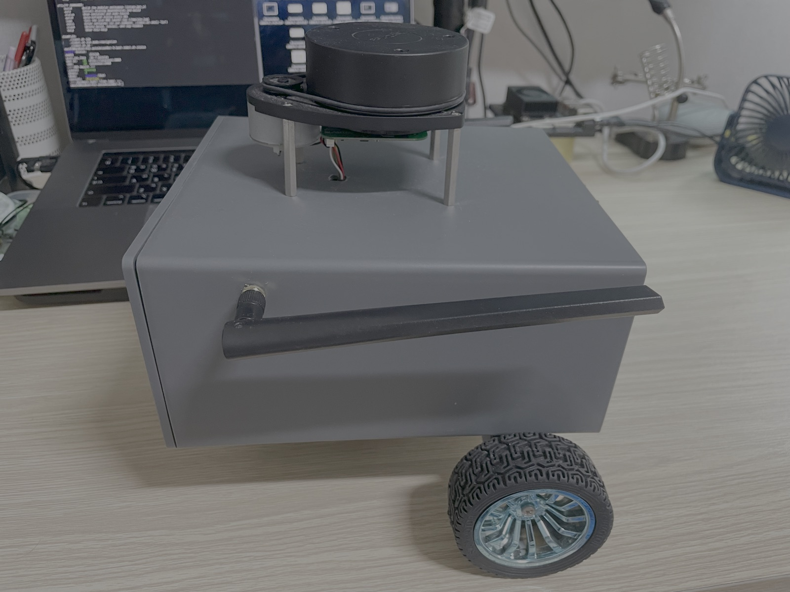
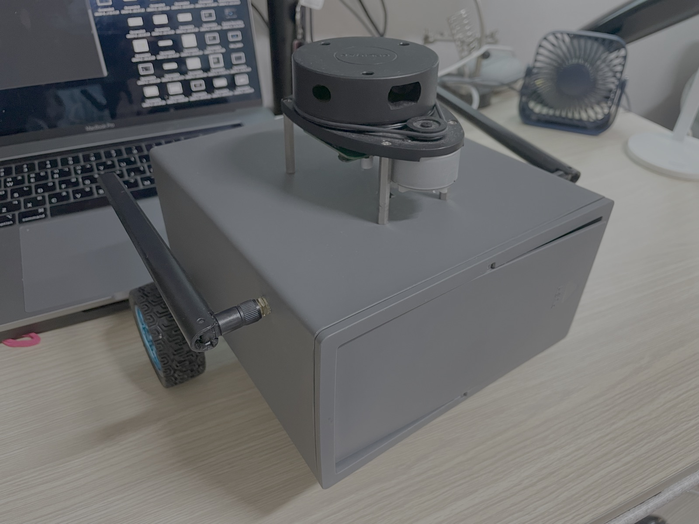
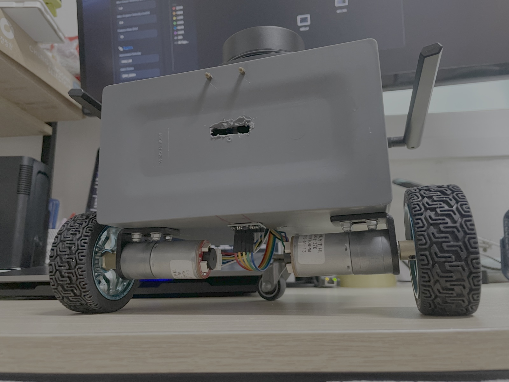
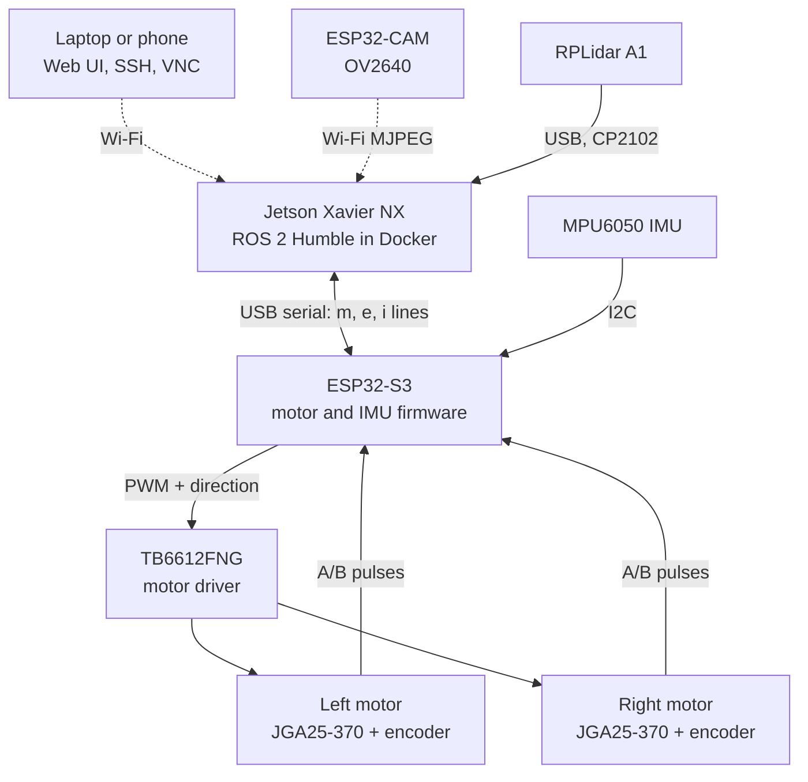
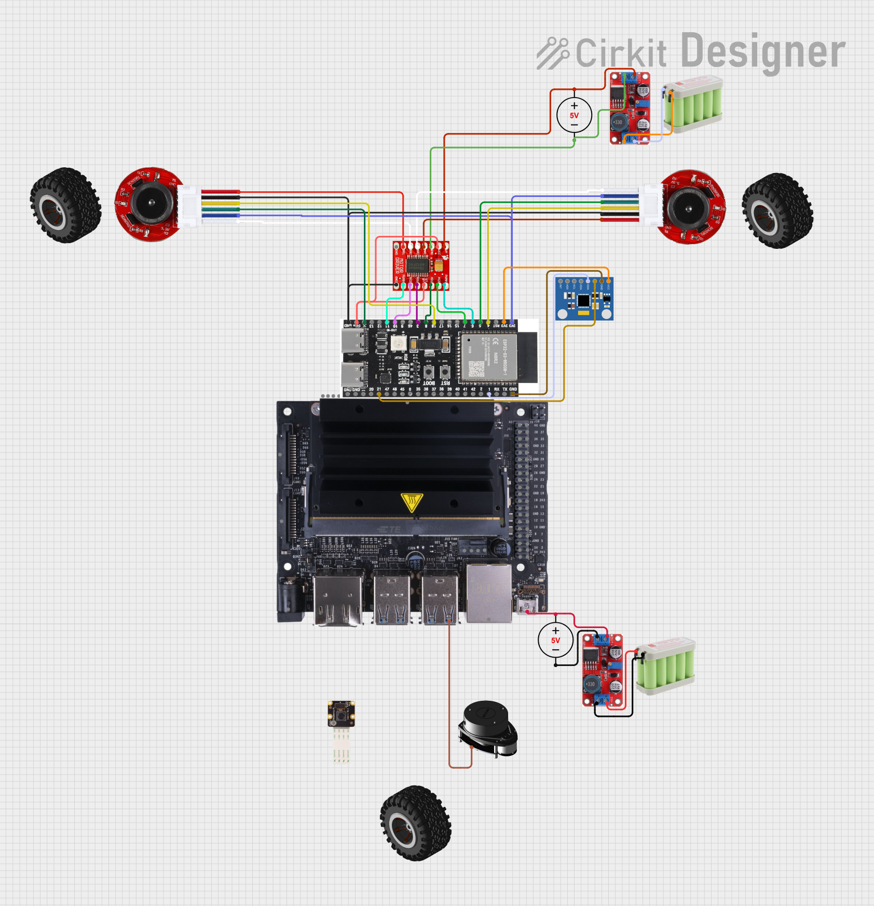

# Hardware

A two-wheel differential-drive robot with a front caster, built around a Jetson Xavier NX. An ESP32-S3 handles the motors, encoders and IMU in real time, and the Jetson runs everything else in ROS 2.

  
  
  
   
  <em>Side · front three-quarter · undercarriage with the two encoder gear motors and the caster</em>

## Components

| Part | Model | Connection | Notes |
| :--- | :--- | :--- | :--- |
| **Computer** | NVIDIA Jetson Xavier NX Developer Kit, 8 GB | Wi-Fi to the network | 6-core Carmel CPU, Volta GPU, 256 GB NVMe. L4T R35.6, Ubuntu 20.04, CUDA 11.4, Docker 28. Runs ROS 2 Humble in the `auto_ros:humble` container, in 20 W 6-core mode |
| **Real-time controller** | ESP32-S3 dev board | Native USB to the Jetson (`303a:1001`, `/dev/ttyACM0`) | Runs [MOTOR-ESP32S3](https://github.com/jakhon37/MOTOR-ESP32S3)'s `gyro-offset-learning` branch (`quadrature-speed-control` plus gyro offsets learned at rest) since 2026-11-10: closed-loop wheel speed on quadrature encoders, encoder and IMU lines at 50 Hz, and motors stopped if no command arrives for 500 ms |
| **Motor driver** | TB6612FNG dual H-bridge | PWM and direction pins from the ESP32-S3 | |
| **Motors** | 2 × JGA25-370 geared DC motors (label reads 170 RPM), 34:1 gearbox | Through the driver | Each has an AB Hall encoder with 11 pulses per motor turn, so 1,497 counts per wheel turn on all 4 edges |
| **Wheels** | 68 mm rubber wheels and a front caster | | Wheel separation 0.212 m |
| **IMU** | MPU6050 | I2C to the ESP32-S3 (SDA GPIO 1, SCL GPIO 21) | See [IMU_WIRING.md](IMU_WIRING.md) |
| **Lidar** | Slamtec RPLidar A1 (A1M8-R6) | USB through a CP2102 adapter (`10c4:ea60`) | 360°, about 6.5 scans per second, 360 points per scan |
| **Camera** | AI-Thinker ESP32-CAM (OV2640) | Wi-Fi only, MJPEG at `/stream` | Firmware from [myESP32CAM-BLACKBOX](https://github.com/jakhon37/myESP32CAM-BLACKBOX). Powered over USB without a data connection, so it can't be mistaken for the lidar's serial port |
| **Power** | Not documented yet | | The Xavier NX dev kit takes 9 to 20 V. The original design (below) used 5 V rails for a Jetson Nano |

## How It Connects

## ESP32-S3 Pin Map

From the `MOTOR-ESP32S3` firmware the board runs since 2026-11-10, and checked on the robot: each wheel turned when driven alone, and both encoder channels counted in the hand test.

| Signal | GPIO | Signal | GPIO |
| :--- | :---: | :--- | :---: |
| Left motor PWM (PWMA) | 11 | Right motor PWM (PWMB) | 6 |
| Left direction (AIN1, AIN2) | 3, 10 | Right direction (BIN1, BIN2) | 8, 7 |
| Left encoder A, B | 18, 14 | Right encoder A, B | 4, 5 |
| IMU SDA | 1 | IMU SCL | 21 |
| Driver STBY | tied high | RGB status LED | 48 |

## Physical Parameters

The dimensions were measured on 2026-06-07. These are the values the code uses.

| Parameter | Value | Where it's set |
| :--- | :--- | :--- |
| Wheel radius | 0.034 m | URDF (`robot_core.xacro`), sim controller (`unified_robot_config.yaml`), bridge (`main.launch.py`) |
| Wheel separation | 0.212 m, centre to centre | Same three places |
| Chassis | 19.4 × 17.8 × 9.7 cm box, centred 6.1 cm ahead of the axle | `robot_core.xacro` |
| Ground clearance | 0.056 m, floor to chassis floor | `robot_core.xacro` |
| Lidar | 0.064 m ahead of the axle, 0.161 m above the chassis floor (0.217 m above the ground) | `lidar.xacro` |
| IMU frame | 0.1 m above the chassis floor on the axle line, upside down (roll π). Not measured | `imu.xacro` |
| Mass | 1.4 kg recorded in the June audit. The URDF's links add up to 1.7 kg | URDF inertials |
| Encoder counts per wheel turn | 1,497, from a 10-turn hand test on 2026-11-10, see [RESULTS.md](../experiments/RESULTS.md#9-first-drive-with-the-new-motor-firmware) | Bridge parameter `encoder_cpr` in `main.launch.py`, and `ENCODER_CPR` in the motor firmware |

The frames follow REP 120. `base_footprint` sits on the floor, and `base_link` sits on the axle line at chassis-floor height, 0.056 m above it. Parts attached to `base_link` are placed by their height above the chassis floor, so the ground clearance isn't added again.

## Original Wiring Diagram

  

Drawn in Cirkit Designer for the first version of the robot, which had a Jetson Nano. The Raspberry Pi camera module in the drawing isn't wired. The robot now has the Xavier NX and the ESP32-CAM shown above, so use this diagram for the ESP32-S3 side only, and check pins against the table above.

## Reference Sheets

Vendor material, kept for wiring work:

| Sheet | Shows |
| :--- | :--- |
| [encoder_datasheet.jpg](../../assets/reference/encoder_datasheet.jpg) | Encoder wire colours and parameters (11 PPR, 22-pole magnet, 3.3 to 5 V) |
| [encoder_wiring.png](../../assets/reference/encoder_wiring.png) | Encoder connector order: M1, GND, C1 (A), C2 (B), VCC, M2 |
| [rplidar_a1_pinout.jpg](../../assets/reference/rplidar_a1_pinout.jpg) | RPLidar A1M8-R6 connector pinout and power limits |
| [jetson-nano/](../../assets/reference/jetson-nano/) | Jetson Nano pinout and board layout from the first version, no longer in use |
