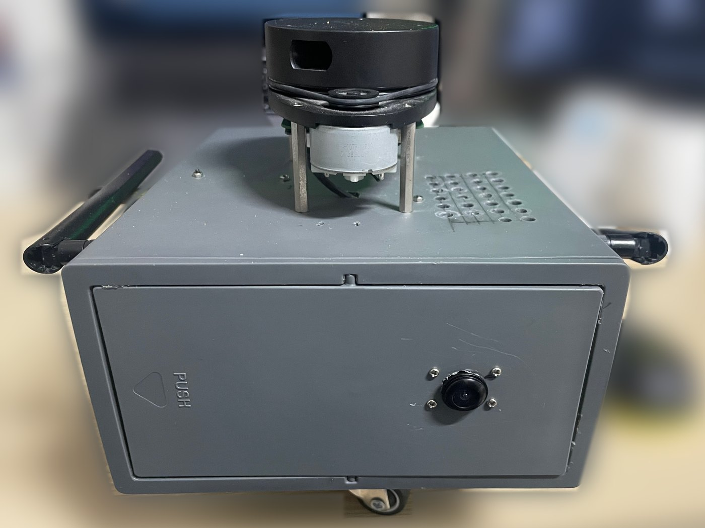
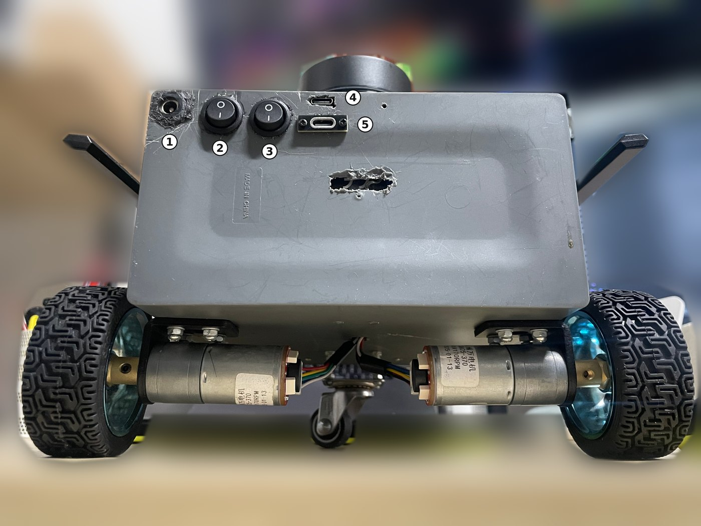
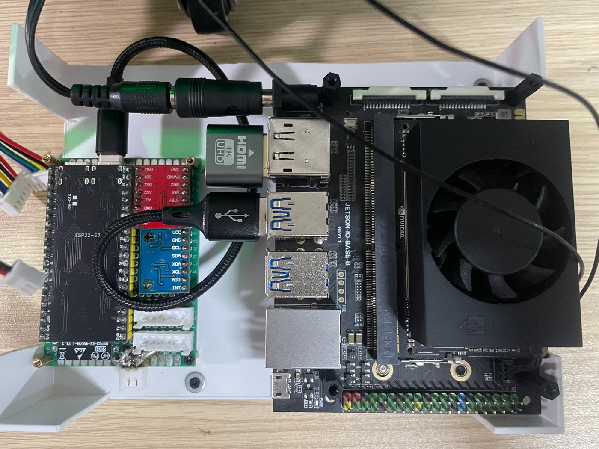
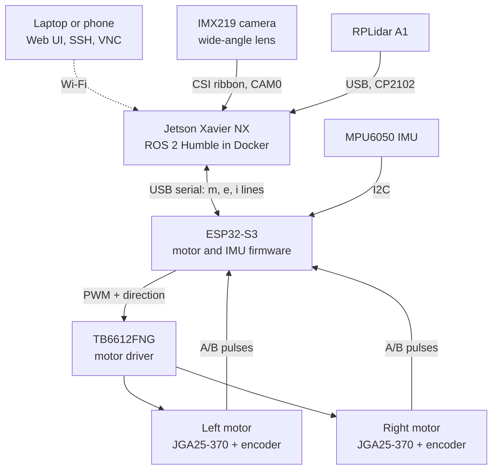

# Hardware

A two-wheel differential-drive robot with a front caster, built around a Jetson Xavier NX. An ESP32-S3 handles the motors, encoders and IMU in real time, and the Jetson runs everything else in ROS 2.

  
  
  
   
  <em>Front with the camera · rear with the power controls, numbered as in <a href="#power">Power</a> · the tray with the motor board and the Jetson, during the build</em>

## Components

| Part | Model | Connection | Notes |
| :--- | :--- | :--- | :--- |
| **Computer** | NVIDIA Jetson Xavier NX module, 8 GB, on a Waveshare JETSON-IO-BASE-B carrier board (rev 1.1) | Wi-Fi to the network | 6-core Carmel CPU, Volta GPU, 256 GB NVMe. L4T R35.6, Ubuntu 20.04, CUDA 11.4, Docker 28. Runs ROS 2 Humble in the `auto_ros:humble` container, in 20 W 6-core mode |
| **Real-time controller** | ESP32-S3 dev board, a copy of Espressif's DevKitC with a CH343 on its COM socket | Native USB to the Jetson (`303a:1001`, `/dev/ttyACM0`) | Runs [MOTOR-ESP32S3](https://github.com/jakhon37/MOTOR-ESP32S3)'s `stamp-encoder-lines` branch since 2026-11-24: `main` (`quadrature-speed-control` plus gyro offsets learned at rest, with the left and right pin sets swapped since 2026-11-23 to match the swapped motor plugs (see the pin map), and feed-forward set on the floor that day), plus the time the counts were read in each encoder line. Closed-loop wheel speed on quadrature encoders, encoder and IMU lines at 50 Hz, and motors stopped if no command arrives for 500 ms. Its 5V pin gets no power from USB |
| **Motor driver** | TB6612FNG dual H-bridge | PWM and direction pins from the ESP32-S3 | Logic supply (VCC, with STBY tied to it) from the ESP32-S3's 3.3 V since 2026-11-23, since the board's 5V pin is dead on USB. The motors run from VM, which the motor battery feeds through a 5 V power-bank board and an adjustable converter (see [Power](#power)) |
| **Motors** | 2 × JGA25-370 geared DC motors (label reads 170 RPM), 34:1 gearbox | Through the driver | Each has an AB Hall encoder with 11 pulses per motor turn, so 1,497 counts per wheel turn on all 4 edges |
| **Wheels** | 68 mm rubber wheels, and a swivel caster with a 26 mm wheel under the front | | Wheel separation 0.212 m. The caster's plate hangs on four bolts under the chassis floor |
| **IMU** | MPU6050, on a GY-521 board | I2C to the ESP32-S3 (SDA GPIO 1, SCL GPIO 21) | On the motor board, chip side down. See [IMU_WIRING.md](IMU_WIRING.md) |
| **Lidar** | Slamtec RPLidar A1 (A1M8-R6) | USB through a CP2102 adapter (`10c4:ea60`) | 360°, about 6.5 scans per second, 360 points per scan. Its motor runs whenever nothing holds the port, so `./robot.sh stop` and `./robot.sh lidar-off` hold it stopped |
| **Camera** | 8 MP Sony IMX219 camera module with a wide-angle lens | CSI ribbon to the Xavier NX's CAM0 connector | Published as `/camera/image_raw` at 15 fps, 820×616 over the full field of view (see [Camera](#camera)). Replaced a Wi-Fi ESP32-CAM ([myESP32CAM-BLACKBOX](https://github.com/jakhon37/myESP32CAM-BLACKBOX)) in November 2026 |
| **Power** | A battery for the Jetson and another for the motors, and a DC jack for the Jetson's mains adapter | Three switches, and a USB-C charging socket for each battery | See [Power](#power) |

## Body

A grey plastic project box, 19.4 × 17.8 × 9.7 cm, with the drive wheels at its rear end and the caster under its front. Its inside was rebuilt on 2026-11-15 to 17.

- **Front cover.** The box's own cover closes the front. It clips on, and most of it is a push door. The door turns on two pins, about a vertical line through the middle of the face, and the camera is screwed to it left of that line. So the door's seat sets the camera's yaw, about 1.5° for each millimetre at the camera: check the camera's yaw and tilt after the door has been pushed or the cover has been off.
- **Tray.** A white tray on brass posts, held down by screws, carries the Jetson on its carrier board, to the robot's left, and the ESP32-S3 motor board, to its right. Everything on it connects through plugs, and the tray comes out through the front.
- **Motor board.** A 50 × 70 mm perfboard. The ESP32-S3, the TB6612FNG and the IMU plug into it face down. The two motor leads, a 6-pin XH-type plug each for a motor and its encoder, and the 2-pin motor supply lead plug in from above.
- **Under the top.** The motor supply's two boards hang under the box's top, above the motor board. The Jetson's battery is at the back of the box.
- **Cooling.** 35 holes in the left wall and 26 in the top, beside and above the Jetson's fan.
- **Antennas.** Two hinged Wi-Fi antennas, one on each side wall. Folded back along the sides they stay inside the 0.19 m circle that Nav2 takes the robot for, and below the lidar's scan plane. Swung out sideways they reach about 0.28 m from the axle's centre, and stood up they stand in the lidar's view.

Photos from before the rebuild: [side](../../assets/photos/robot_side.jpg), [front](../../assets/photos/robot_front_three_quarter.jpg), [underside](../../assets/photos/robot_undercarriage.jpg).

## Power

The Jetson and the motors have separate supplies, so the wheels can be switched off while the Jetson stays up. The numbers are the ones on the rear photo at the top.

| | Control | What it does |
| :---: | :--- | :--- |
| 1 | DC jack | Takes the Jetson's mains adapter |
| 2 | Switch nearest the jack | Feeds the Jetson from the adapter |
| 3 | Switch next to it | Feeds the Jetson from its battery |
| 4 | Upper USB-C socket | Charges the Jetson's battery |
| 5 | Lower USB-C socket | Charges the motor battery |
| | Switch on the right side wall | Turns the motor supply on |

**Jetson.** The carrier board has one DC input, marked 9 to 19 V. The adapter and the battery, a blue pack, reach it through the same lead, each through its own switch. No diode or changeover between the two was seen, so have only one of the two switches on at a time.

**Motors.** A single lithium pouch cell feeds a USB power-bank board, marked HY002-V2, which gives 5 V. An adjustable USB converter with a trimmer, labelled for 5 V in and 1 to 24 V out, is set to about 6 V for the motor driver's VM. The trimmer sets the voltage the motors run on, so the feed-forward set on the floor on 2026-11-23 holds only while it stays where it is, and it can go well above the TB6612FNG's 13.5 V limit.

**Logic.** The ESP32-S3 runs from the Jetson's USB, and the driver's logic from the ESP32-S3's 3.3 V. So the motor board answers with the motor switch off, and a PWM with no motion means check that switch and the motor battery first.

**Not recorded yet.** The Jetson battery's type and voltage, the motor cell's capacity, a measured value of the motor supply's voltage, and the rating of the glass fuse in one of the leads under the top. Nothing measures either battery, and the dashboard's battery value is simulated.

## How It Connects

## ESP32-S3 Pin Map

The physical wiring since 2026-11-23, from the `MOTOR-ESP32S3` firmware and checked on the robot: with the wheels lifted, each channel turned its own wheel forward when driven alone, and on the floor a left turn went left. Both encoder channels counted, by hand on 2026-11-10 and under power on 2026-11-23.

| Signal | GPIO | Signal | GPIO |
| :--- | :---: | :--- | :---: |
| Left motor PWM (PWMB) | 6 | Right motor PWM (PWMA) | 11 |
| Left direction (BIN1, BIN2) | 8, 7 | Right direction (AIN1, AIN2) | 3, 10 |
| Left encoder A, B | 4, 5 | Right encoder A, B | 18, 14 |
| IMU SDA | 1 | IMU SCL | 21 |
| Driver STBY | tied to the driver's VCC (3.3 V) | RGB status LED | 48 |

Since the rewiring on 2026-11-23 the two motor plugs are swapped left for right against the wiring of 2026-11-10, each carrying its motor and its encoder: the driver's A side and encoder pins 18 and 14, the left wheel's until then, now go to the right wheel. The firmware's `config.h` swaps the two pin sets to match. If the plugs are ever put back, flash `main`'s pin map again, and check which wheel turns when one channel is driven, not only that it turns forward.

## Camera

Argus, NVIDIA's camera stack, runs on the Jetson host and isn't in the ROS container. So the camera is read in two steps:

1. **On the host,** [`tools/csi_camera_server.py`](../../tools/csi_camera_server.py) reads the camera with `nvarguscamerasrc` in its 1640×1232 mode, which keeps the full field of view. The Jetson's video hardware scales the frames to 820×616 at 15 fps. The script corrects their colour (below) and serves them as an MJPEG stream on `127.0.0.1:8091`, each frame tagged with its capture time. The Jetson's JPEG engine encodes them, through `nvjpegenc` ([`tools/camera_jpeg.py`](../../tools/camera_jpeg.py)), from full-range YCbCr that the script makes, since `nvvidconv`'s own conversion would leave black at 16 and white at 235. If the engine doesn't start or stops answering, the script encodes with OpenCV instead, and `/health` says which, `jpeg=hardware` or `jpeg=software`. The script uses about a third of one of the Jetson's six cores, more than half of that in Argus's capture threads, and NVIDIA's `nvargus-daemon` another quarter. Encoding in software, it used three quarters.
2. **In the container,** `jetson_bot_camera`'s `mjpeg_camera_node` publishes each JPEG on `/camera/image_raw/compressed`. While anything subscribes, such as RViz, it also publishes decoded `bgr8` frames on `/camera/image_raw`. Both use the frame `camera_optical_link`. With each compressed frame it publishes the lens calibration on `/camera/camera_info`, with the frame's own header. The Web UI shows the compressed topic through `web_video_server`'s `ros_compressed` stream, which passes the JPEGs on as they are, so nothing decodes or re-encodes frames for it.

`./robot.sh robot` starts the server when the Jetson has `/dev/video0`, and `./robot.sh stop` stops it. If the camera is mounted turned, set `CAMERA_FLIP`, for example `CAMERA_FLIP=2 ./robot.sh robot` for upside down. `./robot.sh help` lists the values. The node takes any MJPEG URL through the launch argument `camera_url`, so it could read an ESP32-CAM's stream too.

**Colour.** With the Jetson's default tuning, this camera and lens give everything a magenta cast, which turns pink toward the edges. On white paper over the lens, red came out up to 16% above green overall and nearly 50% above it at the edges. [`tools/camera_shading.py`](../../tools/camera_shading.py) measures this on white paper and corrects red and blue against green in every frame, so white comes out neutral grey all over. Green and brightness are left alone, so uneven light on the paper doesn't matter, and the dark corners don't get noisier. The measurement is in [`tools/camera_color_shading.json`](../../tools/camera_color_shading.json), which the server loads at start. To measure again, tape white paper over the whole lens under the room's usual light, then run `./robot.sh camera-color`. It refuses a picture that isn't plain or that is clipped to white. It hasn't been checked in daylight yet.

**Lens and calibration.** The lens was refocused by hand on 2026-11-23, sharp from about 0.5 m to the far wall, and locked on 2026-11-24 without losing focus. Its calibration, in [`src/jetson_bot_camera/config/imx219_wide_820x616.yaml`](../../src/jetson_bot_camera/config/imx219_wide_820x616.yaml), is OpenCV's rational model with a focal length of 448 by 452 pixels and the optical centre at 408.5, 314.1. The lens sees about 95° across, 80° down and 105° corner to corner. The calibration is provisional: its six views reached only the middle of the picture, so the focal length is known to about 5 pixels and the centre to 7 to 9, and the outer part of the picture is extrapolated. [`tools/camera_intrinsics.py`](../../tools/camera_intrinsics.py) captures views and fits it again ([HARDWARE_BRINGUP.md](../guides/HARDWARE_BRINGUP.md#camera)). It holds for 820×616 frames with `CAMERA_FLIP` at 0: the node publishes no `camera_info` for frames of another size, but a flip that keeps the size would make it wrong, so calibrate again after changing either. Experiment 21 in [RESULTS.md](../experiments/RESULTS.md) has the measurements.

**Mounting.** The camera sits on the chassis's front face, 3.75 cm left of the centre line, halfway up the face. `camera_link` is 0.158 m ahead of the axle and 0.0485 m above the chassis floor, 0.1045 m above the ground. It looks 7.0° down, with its left side 2.3° up. The position is from a ruler and the chassis's measurements, and the tilt from a checkerboard standing level in the calibration views. Its yaw wasn't measured.

### What Camera-Based Docking Can Rely On

Docking itself is a separate project. This is what the robot provides for it:

| What | Since 2026-11-24 |
| :--- | :--- |
| Images | `/camera/image_raw/compressed`, `sensor_msgs/CompressedImage`, JPEG at quality 80, every frame. `/camera/image_raw`, `bgr8`, decoded only while something subscribes. Both reliable, depth 2 |
| Calibration | `/camera/camera_info` with every compressed frame, with its header. `rational_polynomial`, from the file above. Provisional: good in the middle of the picture, extrapolated near its edges |
| Frame | `camera_optical_link`, z forward, x right, y down, as REP 103 has it for cameras. Its parent `camera_link`, x forward, is on `chassis` |
| Size and rate | 820×616 at 15 fps, the sensor's whole 1640×1232 view, scaled |
| Stamps | The capture time from Argus, in the Jetson's clock, which the container shares |
| Delay | With the whole stack up, frames reach a subscriber in the container a median 18 to 21 ms after capture, 95% within 20 to 24 ms |
| CPU | The camera server about a third of a core, `nvargus-daemon` about a quarter, the camera node 4 to 5% |
| Frame size | About 90 KB by day and 250 KB at night, when the sensor's noise rises |
| Colour | Corrected on the host from white paper under the room's ceiling light. Not checked in daylight |

Bearings should come from the calibration: undistort the marker's corners with `cv2.undistortPoints` and the `camera_info`, then take the angle. A plain pinhole model with the calibrated focal length is within 0.2° out to about 13° off the axis, but 1.5° short at 26° and 5° short beyond 39°. The docking project's 62.2° field of view, a placeholder for the old ESP32-CAM, puts a marker that is 13° off the axis at 8.4°. The robot runs no `image_proc` and publishes no rectified images. Its own interface named `camera_link` as the images' frame, and the images use `camera_optical_link`.

## Physical Parameters

The chassis and wheels were measured on 2026-06-07 and the camera on 2026-11-24. The caster, the lidar's height and the IMU's place were read from photos of the rebuilt body on 2026-11-26. These are the values the code uses.

| Parameter | Value | Where it's set |
| :--- | :--- | :--- |
| Wheel radius | 0.034 m | URDF (`robot_core.xacro`), sim controller (`unified_robot_config.yaml`), bridge (`main.launch.py`) |
| Wheel separation | 0.212 m, centre to centre | Same three places |
| Chassis | 19.4 × 17.8 × 9.7 cm box, centred 6.1 cm ahead of the axle | `robot_core.xacro` |
| Ground clearance | 0.056 m, floor to chassis floor | `robot_core.xacro` |
| Caster | A swivel caster with a 26 mm wheel. Its swivel axis is on the centre line, 0.115 m ahead of the axle within about 5 mm. When driving forward the wheel trails about 13 mm behind that axis, so it meets the floor about 0.10 m ahead of the axle. In the URDF it is a ball of the wheel's size under the swivel axis | `robot_core.xacro` |
| Lidar | 0.064 m ahead of the axle. `laser_frame` is its scan plane, 0.154 m above the chassis floor (0.210 m above the ground), within about 3 mm: the lidar's base stands on four standoffs on the chassis top, 34 to 38 mm long in photos, and the data sheet puts the plane 21 mm above the base's mounting face. Until 2026-11-26 the frame held 0.161 m, which is about where the head's top is. Its 0° points straight ahead since it was remounted on 2026-11-23 (yaw 0, measured within 1°), and pointed to the robot's right before | `lidar.xacro`, with the same position and yaw in `main.launch.py`, and the yaw in the dashboard's `lidar.js` |
| IMU frame | On the motor board, 0.098 m ahead of the axle, 0.036 m right of the centre line and 0.027 m above the chassis floor, good to about a centimetre. Upside down (roll π), as the chip faces down. Which way the board's x and y point isn't checked, and the EKF uses only the yaw rate | `imu.xacro` |
| Camera | On the front face, 0.158 m ahead of the axle, 0.0375 m left of the centre line, 0.0485 m above the chassis floor (0.1045 m above the ground). It looks 7.0° down with its left side 2.3° up, measured on 2026-11-24. Yaw not measured | `camera.xacro` |
| Mass | 1.4 kg recorded in the June audit, before the rebuild. The rebuilt robot hasn't been weighed. The URDF's links add up to 1.7 kg | URDF inertials |
| Encoder counts per wheel turn | 1,497, from a 10-turn hand test on 2026-11-10, see [RESULTS.md](../experiments/RESULTS.md#9-first-drive-with-the-new-motor-firmware) | Bridge parameter `encoder_cpr` in `main.launch.py`, and `ENCODER_CPR` in the motor firmware |

The frames follow REP 120. `base_footprint` sits on the floor, and `base_link` sits on the axle line at chassis-floor height, 0.056 m above it. Parts attached to `base_link` are placed by their height above the chassis floor, so the ground clearance isn't added again.

## Original Wiring Diagram

  

Drawn in Cirkit Designer for the first version of the robot, which had a Jetson Nano. The Raspberry Pi camera module in the drawing isn't wired. The robot now has the Xavier NX and the CSI camera listed above, so use this diagram for the ESP32-S3 side only, and check pins against the table above. Since 2026-11-23 the driver's VCC comes from 3.3 V, not the 5V pin the drawing shows, and the motor plugs are swapped left for right (see the pin map). Its two battery packs with converters are the first version's power. No drawing shows the supplies under [Power](#power) yet.

## Reference Sheets

Vendor material, kept for wiring work:

| Sheet | Shows |
| :--- | :--- |
| [encoder_datasheet.jpg](../../assets/reference/encoder_datasheet.jpg) | Encoder wire colours and parameters (11 PPR, 22-pole magnet, 3.3 to 5 V) |
| [encoder_wiring.png](../../assets/reference/encoder_wiring.png) | Encoder connector order: M1, GND, C1 (A), C2 (B), VCC, M2 |
| [rplidar_a1_pinout.jpg](../../assets/reference/rplidar_a1_pinout.jpg) | RPLidar A1M8-R6 connector pinout and power limits |
| [jetson-nano/](../../assets/reference/jetson-nano/) | Jetson Nano pinout and board layout from the first version, no longer in use |
