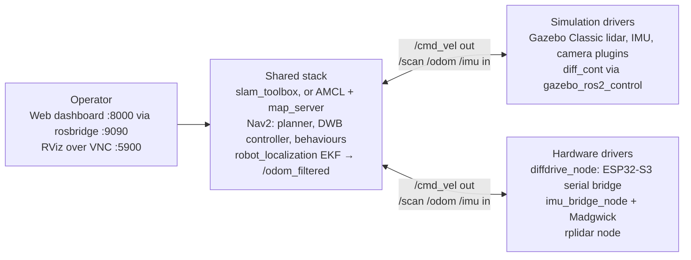
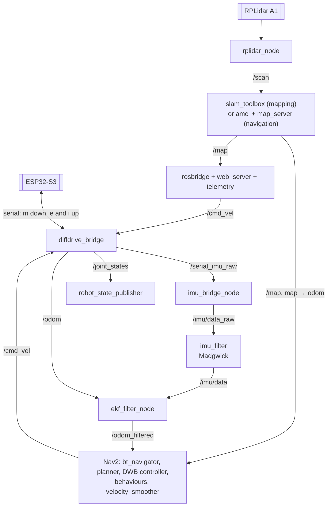
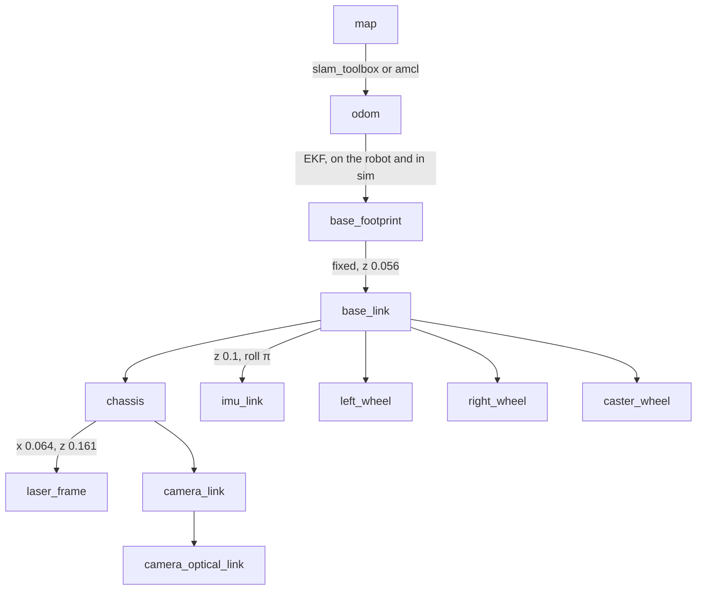
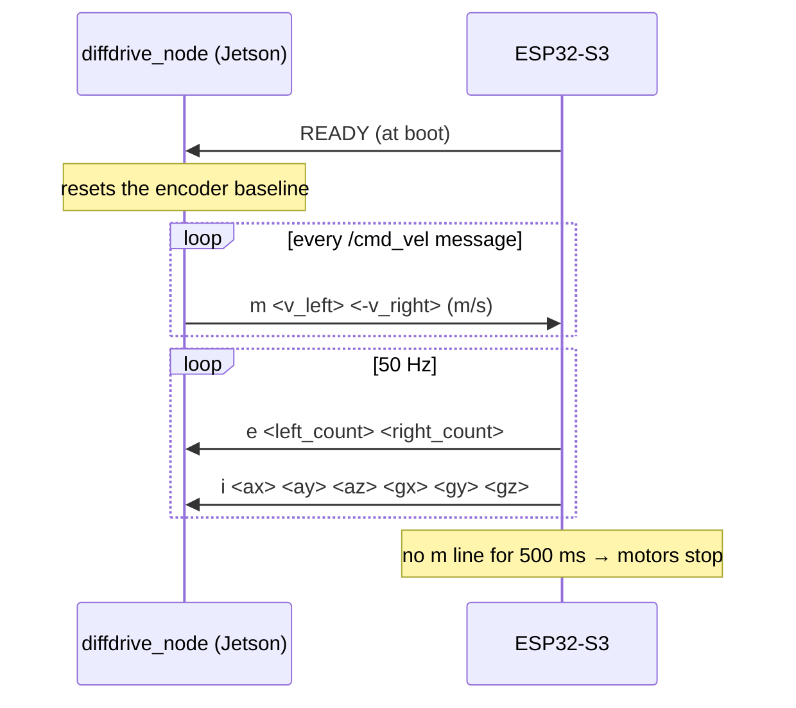
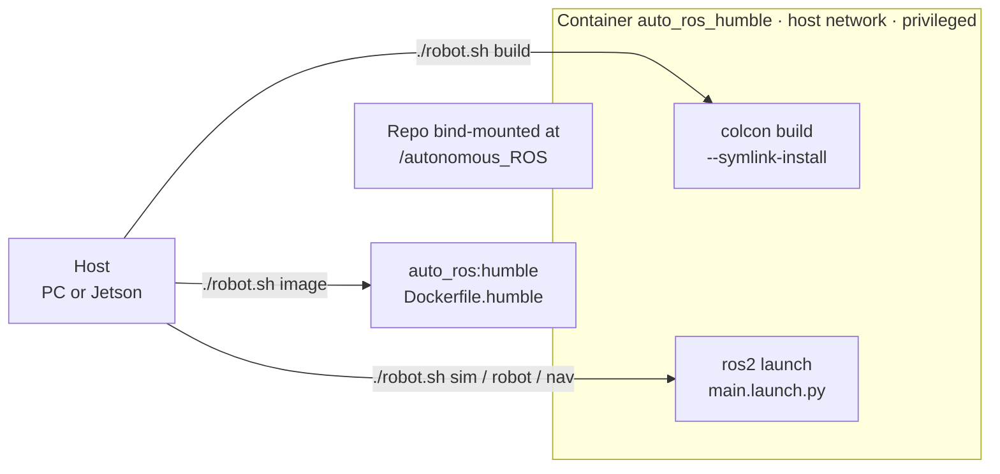

# System Architecture

How the software fits together: the main idea, the launch modes, the ROS 2 node graph on the robot and in simulation, the TF tree, the serial protocol to the ESP32-S3, and the Docker workflow. The parts themselves are in [HARDWARE.md](HARDWARE.md).

## Main Idea

One ROS 2 stack serves two robots: a Gazebo digital twin and the real one. Both publish the same topics (`/scan`, `/odom`, `/imu`, `/joint_states`) and frames, and both take `/cmd_vel`. Mapping, localization, navigation and the dashboard don't know which one they're driving. Only the bottom layer changes.

## Launch Modes

`robot.sh` runs `ros2 launch jetson_bot_bringup main.launch.py` in the `auto_ros_humble` container. The launch file reads `unified_robot_config.yaml`, and command-line arguments override it.

| Command | Arguments passed | Result with the committed YAML (`use_sim: false`, `mode: mapping`) |
| :--- | :--- | :--- |
| `./robot.sh up` | none | Hardware, mapping, RViz |
| `./robot.sh sim` | `sim:=true viz:=true` | Gazebo with its window, mapping, RViz |
| `./robot.sh robot` | `sim:=false viz:=false` | Hardware, mapping, no RViz |
| `./robot.sh nav` / `map2nav` | `mode:=navigation`, after saving the map if mapping | Hardware, Nav2, RViz |
| `./robot.sh sim mode:=navigation` | `sim:=true viz:=true mode:=navigation` | Gazebo with Nav2 |

The launch file also adapts to the ROS distro: Humble gets `spawner`, `slam_params_file` and `nav2_params_humble.yaml`, and Foxy gets `spawner.py`, `params_file` and `nav2_params.yaml`.

## Node Graph on the Robot

| Node | Package | Started when | Notes |
| :--- | :--- | :--- | :--- |
| `diffdrive_bridge` | `jetson_bot_diffdrive` | An ESP32 port is found | Wheel radius 0.034 m, separation 0.212 m, `encoder_cpr` 3,436, `publish_tf: false` |
| `imu_bridge_node` | `jetson_bot_imu` | Always in hardware mode | Parses the raw `i` lines into `sensor_msgs/Imu` in `imu_link` |
| `imu_filter` | `imu_filter_madgwick` | Always in hardware mode | `stateless: true`, `use_mag: false`, `publish_tf: false` |
| `ekf_filter_node` | `robot_localization` | Always | 30 Hz, publishes `/odom_filtered` and `odom → base_footprint` |
| `rplidar_node` | `rplidar_ros` | A CP210x lidar port is found | `laser_frame`, 115200 baud, Standard scan mode |
| `slam_toolbox` | `slam_toolbox` | Mapping mode, 2 s after launch | Async mode, `mapper_params.yaml` |
| AMCL, map server, Nav2 servers | `nav2_bringup` | Navigation mode, 2 s after launch | `nav2_params_humble.yaml`, map from `maps/` |
| `robot_state_publisher` | `robot_state_publisher` | Always | URDF from `robot.xacro` |
| `rosbridge_websocket`, `web_server_node`, `telemetry_node` | `rosbridge_server`, `jetson_bot_gui` | Always | Ports 9090 and 8000. Telemetry runs at 1 Hz, and its battery value is simulated |
| `web_video_server` | `web_video_server` | If installed | Port 8080. Nothing publishes `/camera/image_raw` on the robot yet |

The launch file starts the bridge and lidar only when it finds their USB devices, so it doesn't crash on a machine without them. SLAM or Nav2 still starts if either one is found.

## Node Graph in Simulation

The upper layers are the same. The drivers are replaced like this:

| On the robot | In simulation |
| :--- | :--- |
| `diffdrive_bridge` takes `/cmd_vel` and publishes `/odom` and `/joint_states` | `diff_cont` (diff_drive_controller in gazebo_ros2_control) takes `/cmd_vel` and publishes `/odom`, and `joint_broad` publishes `/joint_states` |
| `imu_bridge_node` and Madgwick produce `/imu/data` at 50 Hz | Gazebo's IMU plugin publishes `/imu` at 100 Hz straight to the EKF |
| `rplidar_node` publishes `/scan` at about 6.5 Hz | Gazebo's lidar plugin publishes `/scan` at 10 Hz, 360 samples, 0.3 to 12 m |
| No camera topic | Gazebo's camera plugin publishes `/camera/image_raw`, 640×480 at 10 Hz |

Gazebo needs time to start, so the launch staggers things: the robot spawns at 5 s, the EKF starts at 15 s, the controllers at 90 s, and SLAM or Nav2 at 120 s.

## TF Tree

- **Moving transforms:** `map → odom` comes from `slam_toolbox` while mapping and from AMCL while navigating. `odom → base_footprint` comes from the EKF, on the robot and in simulation, because the bridge, Madgwick and `diff_cont` have TF publishing turned off.
- **Fixed transforms:** The rest come from `robot_state_publisher`, which reads the wheel angles from `/joint_states`.

## Serial Protocol

The bridge talks to the ESP32-S3 over its native USB (`/dev/ttyACM0`). The messages are plain text, so you can debug them with `screen` or `minicom`.

| Direction | Line | Meaning |
| :--- | :--- | :--- |
| Jetson → ESP32 | `m <v_l> <-v_r>\r` | Wheel speeds in m/s, from `v = vx ∓ ωz · 0.212 / 2`. The right speed is negated before sending |
| ESP32 → Jetson | `e <left> <right>` | Cumulative encoder counts. The bridge negates the right count before computing odometry |
| ESP32 → Jetson | `i <ax> <ay> <az> <gx> <gy> <gz>` | MPU6050 readings in m/s² and rad/s, passed on as `/serial_imu_raw` |
| ESP32 → Jetson | `READY` | The board rebooted, so the bridge takes the next counts as its new baseline |

**Odometry:** Each `e` line becomes a distance per wheel (`counts / encoder_cpr × 2π × 0.034`). The bridge takes the change since the last line, integrates the pose at the midpoint heading, and publishes `/odom` and `/joint_states`. Speeds divide that change by the time the line covers: the lines read in one 20 ms tick share the time since the last tick that had any, and none counts as shorter than one 50 Hz period (`encoder_rate`). The first line after connecting only sets the baseline, so `/odom` starts at zero.

**Keep-alive:** The bridge doesn't resend commands, so the motors keep running only while something streams `/cmd_vel`. The dashboard sends at 10 Hz while a key is held, and Nav2's velocity smoother at 20 Hz.

## Docker Workflow

- **One image:** It holds ROS 2 Humble, Nav2, `slam_toolbox`, `robot_localization`, `rosbridge`, `web_video_server`, and Gazebo where apt has it (amd64).
- **Bind mount:** The repo is mounted at `/autonomous_ROS`, so a build inside the container writes `build/` and `install/` into the repo folder.
- **Host networking:** The container uses the host's network and runs privileged, so it reaches the USB devices and serves ports 8000, 9090, 8080 and 5900 directly. Docker only sees USB devices present when the container starts.

## Ports

| Port | Service |
| :--- | :--- |
| 8000 | Web dashboard (static HTTP from `jetson_bot_gui`) |
| 9090 | rosbridge WebSocket, no authentication |
| 8080 | `web_video_server` |
| 5900 | VNC to the container's virtual display (RViz, Gazebo), no password |

Ports 9090 and 5900 have no authentication, so keep the robot on a trusted network or use the SSH tunnel that `./robot.sh remote` prints.

## Known Issues

The status board lists what a code review found while these docs were written. The software fixes from 2026-11-07 (the duplicate simulation transform, odometry speed spikes, zero `/odom` covariance, the dashboard's ROS 1 goal API and more) still need a run in simulation or on the robot. The EKF's yaw input, the IMU frame and the Nav2 footprint are among those still open. See [PROJECT_ANALYSIS.md](../PROJECT_ANALYSIS.md).
