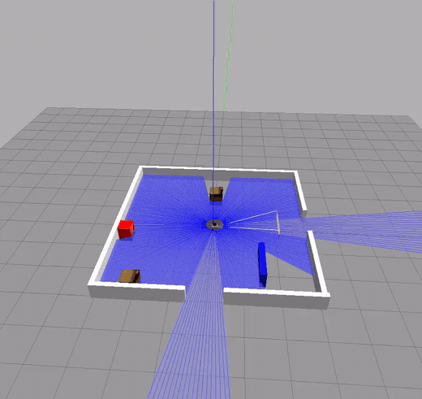
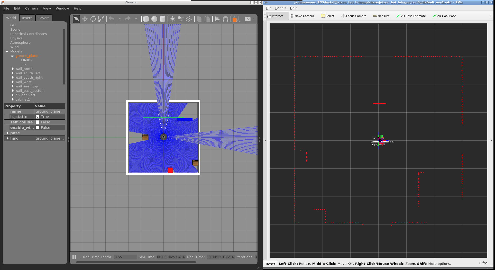
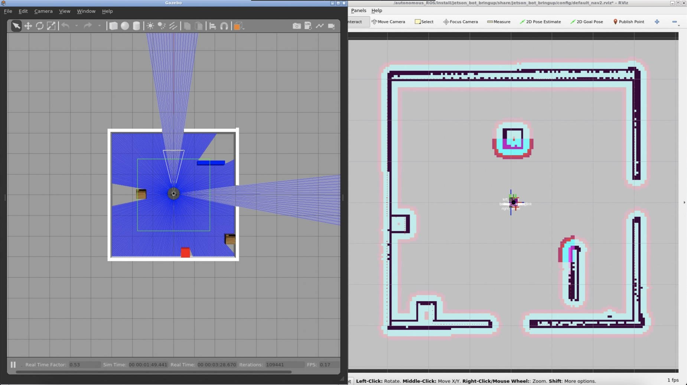
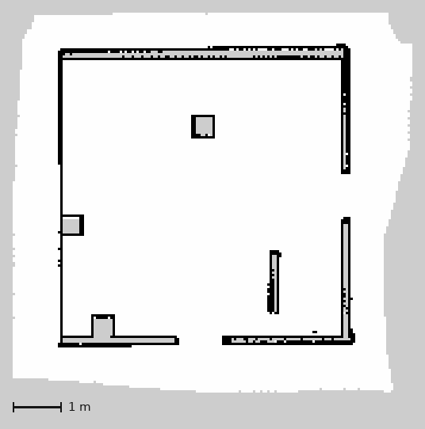
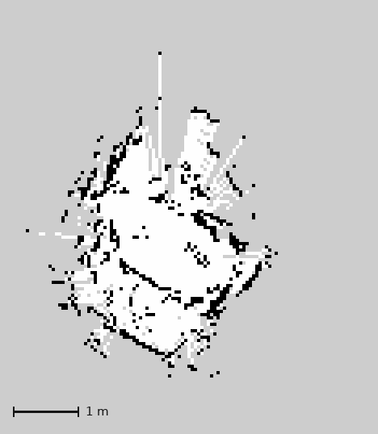
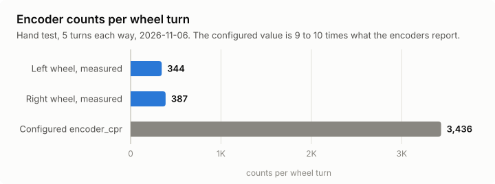
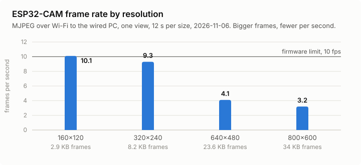
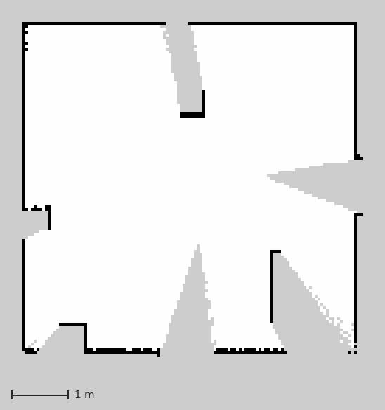
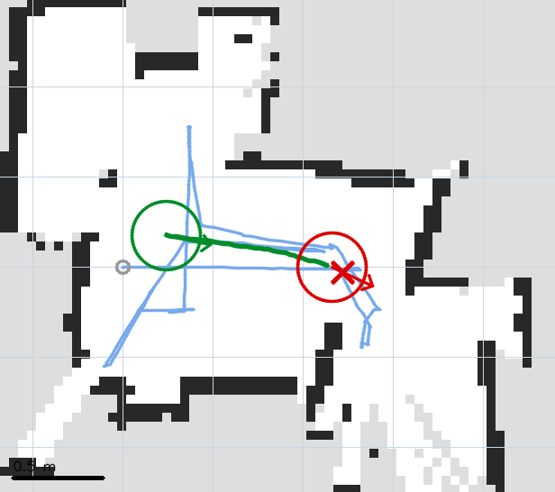

# Experiments and Results

What was tested, on what, and what it showed. Simulation work ran in Docker on a Mac in June 2026, and on an amd64 PC under Humble in November. Hardware work ran on the robot's Jetson Xavier NX under ROS 2 Humble from August to November 2026. Day-by-day detail is in [SESSION_LOG.md](../SESSION_LOG.md), and open problems are on the status board in [PROJECT_ANALYSIS.md](../PROJECT_ANALYSIS.md).

## At a Glance

| # | Experiment | Where | When | Outcome |
| :- | :--- | :--- | :--- | :--- |
| 1 | [SLAM and Nav2 in Gazebo](#1-simulation-mapping-and-navigation-in-gazebo) | Simulation | 2026-06 | Map built and goals reached with fused odometry |
| 2 | [Port to ROS 2 Humble](#2-port-to-ros-2-humble-on-the-xavier-nx) | Xavier NX | 2026-08 to 11 | Stack builds and runs in Docker on the robot |
| 3 | [Lidar and SLAM on the robot](#3-lidar-and-slam-on-the-real-robot) | Robot | 2026-08-21, 11-05 | 6.46 Hz scans, `slam_toolbox` builds a map |
| 4 | [ESP32-S3 telemetry](#4-esp32-s3-telemetry-and-the-tf-chain) | Robot | 2026-11-05 | Encoders and IMU at 50 Hz, full TF chain |
| 5 | [Wheel encoder hand test](#5-wheel-encoder-hand-test) | Robot | 2026-11-06 | Found a 9 to 10× scale error and missing direction before the first drive |
| 6 | [IMU at rest](#6-imu-at-rest) | Robot | 2026-11-05 | Gyro bias of 1.4°/s measured, calibration pending |
| 7 | [ESP32-CAM video over Wi-Fi](#7-esp32-cam-video-over-wi-fi) | Camera | 2026-11-05 to 06 | 10 fps at 320×240, firmware fixes tested on hardware |
| 8 | [Gazebo check of the code review fixes](#8-gazebo-check-of-the-code-review-fixes) | Simulation | 2026-11-09 | Fixes confirmed, and three more bugs found and fixed |
| 9 | [First drive with the new motor firmware](#9-first-drive-with-the-new-motor-firmware) | Robot | 2026-11-09 to 10 | Encoders fixed, 1,497 counts per turn, speeds within 1 to 2% with the wheels lifted |
| 10 | [Driving through ROS and the EKF heading](#10-driving-through-ros-and-the-ekf-heading) | Robot | 2026-11-10 | `/odom` within 3% of commands, and the EKF now follows turns |
| 11 | [Floor tuning, gyro offsets and the EKF](#11-floor-tuning-gyro-offsets-and-the-ekf-on-the-floor) | Robot, simulation | 2026-11-10 | Feed-forward set for the floor, gyro offsets in firmware, and EKF settings that turned straight drives into turns, fixed |
| 12 | [The EKF on the robot and the lidar's frame](#12-the-ekf-on-the-robot-the-lidars-frame-and-the-left-encoder) | Robot, simulation | 2026-11-10 | The EKF matched the wheels and the gyro, and the lidar's frame, 90° off, corrected |
| 13 | [Gyro offsets learned at rest](#13-gyro-offsets-learned-at-rest) | Robot | 2026-11-10 | The firmware re-learns the gyro's offsets whenever the robot stands still, and the EKF's heading held within 0.11°/min at rest |
| 14 | [The CSI camera in ROS](#14-the-csi-camera-in-ros) | Robot | 2026-11-23 | 15 fps on `/camera/image_raw`, 14 ms after capture, shown in the Web UI |
| 15 | [The camera's colour](#15-the-cameras-colour) | Robot | 2026-11-23 | White paper neutral grey to within about 3% across the frame, from a magenta cast that turned pink at the edges |
| 16 | [Hardware recheck after rewiring](#16-hardware-recheck-after-rewiring) | Robot | 2026-11-23 | The left encoder holds under power. Reversed encoder power, a dead 5V pin and reversed motor plugs found and fixed, and the lifted wheels hold 0.100 m/s |
| 17 | [Floor calibration after the rewiring](#17-floor-calibration-after-the-rewiring) | Robot | 2026-11-23 | Floor feed-forward set again, the motor plugs found swapped left for right rather than reversed, and the remounted lidar measured at 0°, after which SLAM matched the wheels |
| 18 | [Mapping run and the first Nav2 goal](#18-mapping-run-and-the-first-nav2-goal) | Robot, simulation | 2026-11-24 | The room mapped as `lab_map_v3`, and the first Nav2 goal on the robot reached: 1.0 m asked, 6.5 cm short by tape, inside the 10 cm tolerance. The EKF's distance read 8.5% short of the wheels under Nav2's load |
| 19 | [Wheel speeds timed by the motor board](#19-wheel-speeds-timed-by-the-motor-board) | Robot | 2026-11-24 | On the same 1 m Nav2 goal, the EKF's distance within 0.1% of the wheels at a load average of 11 to 15, where it had read 8.5% short |
| 20 | [The camera's JPEG on the Jetson's encoder](#20-the-cameras-jpeg-on-the-jetsons-encoder) | Robot | 2026-11-24 | The camera server from three quarters of a core to a third, and frames reach ROS a median 21 ms after capture instead of 36, with the same picture |

---

## 1. Simulation: Mapping and Navigation in Gazebo

**Goal:** Prove the full stack (URDF, `slam_toolbox`, AMCL, Nav2, Web UI) on a digital twin before touching the hardware.

**Setup:** Gazebo Classic with the `lab_small_light` world, ROS 2 Foxy in Docker on macOS, RViz over VNC. The robot model uses the chassis measurements from the 2026-06-07 hardware audit (wheel radius 0.034 m, separation 0.212 m, chassis 19.4 × 17.8 × 9.7 cm, lidar 0.064 m ahead of the axle and 0.217 m above the floor).

  
   
  <em>The robot driving in the Gazebo lab world, lidar rays in blue</em>

| Mapping (Gazebo + RViz scan) | Navigation (Nav2 costmap) |
| :---: | :---: |
|  |  |

  
   
  <em>Occupancy grid of the simulated lab, used by AMCL and Nav2 (<code>src/jetson_bot_bringup/worlds/lab_map_v2.pgm</code>)</em>

**Result:** Mapping and autonomous goals worked in simulation with EKF-fused odometry (`/odom_filtered`). The simulation ran at a real-time factor of about 0.55 in Docker on the Mac. A later code review found that in simulation both the diff-drive controller and the EKF published the `odom → base_footprint` transform. That's fixed, and [experiment 8](#8-gazebo-check-of-the-code-review-fixes) checked it.

**Lessons, recorded in [LESSONS_LEARNED.md](../LESSONS_LEARNED.md):**
- The robot looked stuck until the URDF put `base_footprint` at the floor and the model spawned 6 cm up. The wheels had been under the ground plane.
- Lowering contact stiffness to speed up physics let overlapping geometry push the robot around, so the geometry had to be fixed first.
- Inflation `cost_scaling_factor` sets how fast cost falls away from walls. Low values make walls look thick, and both Nav2 configs settled on 3.5.

---

## 2. Port to ROS 2 Humble on the Xavier NX

**Goal:** Move from the original Jetson Nano with native Foxy to a Jetson Xavier NX running ROS 2 Humble.

**What changed:**
- **Container:** `Dockerfile.humble` builds `auto_ros:humble` (Ubuntu 22.04). The host stays on L4T R35.6 (Ubuntu 20.04), so Docker is what makes Humble possible on this board.
- **Launch:** `main.launch.py` adapts per distro: `spawner.py` becomes `spawner`, `slam_toolbox` takes `slam_params_file`, and Nav2 loads `nav2_params_humble.yaml`.
- **Serial ports:** The ESP32-S3 and the lidar are found by USB ID, because `ttyACM` numbers change when the ESP32 resets.

**Limits found:**
- **Gazebo:** Gazebo Classic has no Humble packages for arm64, so simulation needs an amd64 host. The robot itself runs hardware mode only.
- **Camera:** It turned out to be an ESP32-CAM on Wi-Fi, not the CSI Pi Camera in the old docs, so the kernel's `imx219` errors were expected.

---

## 3. Lidar and SLAM on the Real Robot

**Setup:** RPLidar A1 on the Xavier NX's USB (CP2102 adapter), `rplidar_ros` and `slam_toolbox` in the Humble container.

| Measure | Value |
| :--- | :--- |
| Lidar health | OK (firmware 1.29, hardware rev 7) |
| `/scan` rate | 6.46 Hz, 360 points per scan |
| Valid points | 40%, most of the rest within 30 cm, so something on the chassis is in the beam |

  
   
  <em>Map saved by the robot on 2026-08-21 (<code>maps/lab_map_v2.pgm</code>)</em>

**Result:** `slam_toolbox` builds maps from the real lidar. The August map is smeared, which fits the encoder problems found in experiment 5, since odometry was reporting about a tenth of the real distance at the time. A full mapping run with calibrated odometry is still to come.

---

## 4. ESP32-S3 Telemetry and the TF Chain

**Setup:** ESP32-S3 on its native USB socket (`303a:1001`), the Python bridge `diffdrive_node`, `imu_bridge_node`, the Madgwick filter and the EKF. No motor commands were sent.

| Topic | Rate | Source |
| :--- | :--- | :--- |
| Encoder `e` lines | 50 Hz | ESP32-S3 serial |
| IMU `i` lines | 50 Hz | ESP32-S3 serial |
| `/odom` | 50 Hz | `diffdrive_node` |
| `/joint_states` | 50 Hz | `diffdrive_node` |
| `/imu/data` | 50 Hz | Madgwick filter |
| `/odom_filtered` | 30 Hz | `robot_localization` EKF |

**Result:** The full TF chain `map → odom → base_footprint → base_link → sensors` was present, and `slam_toolbox` built a map with it.

**Fix found here:** On startup the bridge treated the ESP32's accumulated counts as motion, which put `/odom` at (-3.13, -2.72). It now takes its first reading as a baseline, and `/odom` starts at zero (2026-11-05 23:15 in the session log).

---

## 5. Wheel Encoder Hand Test

**Goal:** Check encoder scale and direction before the first powered drive.

**Method:** With the robot still, each wheel was turned by hand 5 times forward and 5 times back, left first, while the counts were logged once a second.

  <picture>
    <source media="(prefers-color-scheme: dark)" srcset="../../assets/results/encoder_counts_dark.svg">
    
  </picture>

| Wheel | Count change over 10 turns | Counts per turn | Configured |
| :--- | ---: | ---: | ---: |
| Left | -3,437 | 344 | 3,436 |
| Right | +3,866 | 387 | 3,436 |

**Findings:**
- **Scale:** The encoders report 9 to 10 times fewer counts per turn than the bridge is configured for, so odometry would show about a tenth of the real distance. The left wheel's 10-turn total is almost exactly 3,436, so that value may have been measured over 10 turns and recorded as one.
- **Direction:** Neither count reversed. The left count only fell and the right only rose, which is what the firmware does when the encoder's B channel reads high, as an unconnected input with a pull-up would. Every motion would then read as backward. This holds if the second five turns really were backward.

**Next:** Done in [experiment 9](#9-first-drive-with-the-new-motor-firmware). Both B channels were dead, and the rebuilt firmware, counting all four edges, measures 1,497 per turn, inside the 1,376 to 1,546 that four times this test's counts predicted.

---

## 6. IMU at Rest

**Setup:** MPU6050 on the ESP32-S3's I2C bus (SDA GPIO 1, SCL GPIO 21), read at 50 Hz and sent over the same serial link as the encoders.

| Measure | Value |
| :--- | :--- |
| Acceleration magnitude | 9.77 m/s² |
| Gyro z at rest | about 0.024 rad/s (1.4°/s) |
| `/odom_filtered` yaw drift | about 0.1°/s |

**Result:** The IMU works, but its gyro bias needs calibrating before it helps the EKF. Gyro values also arrive with only 2 decimals, in steps of 0.01 rad/s, which limits how finely the bias can be estimated.

**Found in code review:** The Madgwick filter runs in `stateless` mode without a magnetometer, so its orientation has no real heading, yet the EKF fused its yaw. [Experiment 10](#10-driving-through-ros-and-the-ekf-heading) showed it pinned the heading, and the EKF now fuses only the IMU's yaw rate. The bridge also published `/odom` with zero covariance, which the EKF treats as near-perfect. Since 2026-11-07 it sends non-zero variances.

---

## 7. ESP32-CAM Video over Wi-Fi

**Setup:** AI-Thinker ESP32-CAM (OV2640) streaming MJPEG over Wi-Fi from its own firmware, [myESP32CAM-BLACKBOX](https://github.com/jakhon37/myESP32CAM-BLACKBOX). It isn't connected to ROS in this repo yet.

**Firmware changes:** Branch `wifi-reliability` of that repo, flashed and tested on the camera:

| Change | How it was checked | Result |
| :--- | :--- | :--- |
| Turn off Wi-Fi power saving | Idle ping, 15 minutes apart | 290 to 330 ms down to about 13 ms (median) |
| Retry home Wi-Fi every 30 s while on the fallback hotspot | Wrong network name, then a 1 ms boot timeout | Hotspot stays up while retries fail. A successful retry joins in about 1 s and turns the hotspot off |
| Restart if the sensor fails to start | Not tested on hardware yet | Previously it halted with no network |

  <picture>
    <source media="(prefers-color-scheme: dark)" srcset="../../assets/results/camera_fps_dark.svg">
    
  </picture>

| Resolution | Frame size | From the wired PC | From the Jetson |
| :--- | ---: | ---: | ---: |
| 160×120 | 2.9 KB | 10.1 fps | Not measured |
| 320×240 | 8.2 KB | 9.3 fps | 9.8 fps |
| 640×480 | 23.6 KB | 4.1 fps | 2.9 fps |
| 800×600 | 34 KB | 3.2 fps | Not measured |

**Findings:**
- **Throughput:** 320×240 runs close to the firmware's 10 fps limit. At 640×480, frame rate falls as frames get bigger, and a 20-minute run averaged about 6 fps.
- **Stalls:** Pauses of up to 3 s at 640×480 aren't explained by bandwidth, and their cause is unknown.
- **Open problems:** One boot gave no frames at all at 640×480 or larger for 20 minutes, while smaller sizes worked. Its cause is unknown. A slowdown the night before, when an 18 KB page downloaded at about 5 KB/s, cleared after the camera moved to a phone charger, but power, position and time of day changed together.
- **Design limits for the ROS node:** The firmware serves one request at a time and its frames carry no timestamps. `/capture` also saves every photo to the SD card, so a ROS node should be the stream's only client, stamp frames on arrival, and avoid polling `/capture`.

---

## 8. Gazebo Check of the Code Review Fixes

**Goal:** Run the 2026-11-07 code review fixes in simulation before they reach the robot.

**Setup:** ROS 2 Humble in Docker on an amd64 PC (Ubuntu 24.04, 12 cores, no GPU), because Gazebo Classic has no Humble packages for arm64. Headless Gazebo ran at a real-time factor of 1.0. The container ran with `ROS_LOCALHOST_ONLY=1`, so nothing it published could reach the robot on the same network.

| Check | Result |
| :--- | :--- |
| `diff_cont`'s transform turned off | `enable_odom_tf` reads false |
| Only the EKF publishes `odom → base_footprint` | 90 of 90 samples equal an `/odom_filtered` pose with the same stamp |
| Transform while driving | Largest step 1.5 cm, none out of order |
| Simulated `/odom` covariance | The same non-zero values as the robot's bridge |
| `run_tests.py --docker` with the stack up | 10 of 10 passed |
| Dashboard goals | Reached Nav2 and succeeded |
| Dashboard cancel | Robot stopped within 0.6 s of the click |

**Found: the simulated EKF turned the wrong way.** The URDF mounts the IMU upside down (roll π), and its Gazebo plugin named no frame. Gazebo merges links on fixed joints, so the readings were stamped `base_footprint`, and the EKF fused them without rotating them back. The diff-drive controller's own transform had hidden this until the fix above turned it off.

| Heading change in a 4 s counter-clockwise spin | Before | After |
| :--- | ---: | ---: |
| `/odom` from the wheels | +100° | +100° |
| `/imu` orientation | +95° | +95° |
| EKF (`/odom_filtered` and its transform) | −86° to −95° | +95° |

  
   
  <em>SLAM map built in Gazebo under Humble after the fixes (2026-11-09)</em>

With the heading reversed, SLAM drew the room rotated with doubled walls. Nav2 weaved on a straight 1.7 m goal, turning at up to 0.84 rad/s and drifting 18 cm sideways in its first metre. Naming the frame `imu_link` in `imu.xacro` fixed both: SLAM now draws the room's walls straight (above), and the same goal drifted 7 cm over 1.5 m. A unit test now checks the frame.

**Found: the dashboard badge stuck at Canceling.** Nav2 sends CANCELED 20 ms after CANCELING and publishes status only on a change. The dashboard throttled that topic to one message per 500 ms, and rosbridge drops messages inside the window rather than delaying them, so CANCELED never arrived. Without the throttle, the badge goes from Executing through Canceling to Idle within 30 ms of the cancel.

**Found: the simulated camera's frame.** `camera.xacro` used ROS 1's `<frameName>` tag, which the ROS 2 plugin ignores, so the images were stamped `base_footprint`. With `<frame_name>` they're stamped `camera_optical_link`, and the unit test covers the camera too.

**Result:** Every fix that simulation can exercise works, and all three new bugs are fixed. The bridge's odometry changes can only be checked on the robot. Still open from this run: Gazebo's 10 Hz clock holds the EKF to 10 Hz, and simulated navigation loads the robot's map by default.

---

## 9. First Drive with the New Motor Firmware

**Goal:** Put the rebuilt motor firmware on the ESP32-S3, fix whatever stopped the encoders, and drive both wheels for the first time under Humble.

**Setup:** The robot on a stand with the wheels lifted about 5 mm. The firmware is the `quadrature-speed-control` branch of [MOTOR-ESP32S3](https://github.com/jakhon37/MOTOR-ESP32S3): quadrature decoding on all 4 edges in hardware, feed-forward plus a closed loop per wheel, and a 500 ms command timeout. Its `wheel_test.py` ran in the Jetson's container, following that repo's first-drive checklist. The old firmware, never committed, was backed up first.

**Found and fixed:**
- **Board in download mode:** After the Jetson rebooted, every reset through the USB control lines started the ESP32-S3 in ROM download mode (`boot:0x2`), silent with the motors off. Unplugging its USB cable for 5 s fixed it.
- **No motor power:** The first commands raised the PWM but moved nothing, until the motor battery was connected to the driver.
- **Dead B channels:** In a 3 s drive, channel A changed 282 times on the left and 281 on the right, and B never changed. The left green wire was broken, and the firmware expected the left B on GPIO 17, while the wiring diagram and the robot have it on 14. With all 4 edges counted, a stuck B cancels every A pulse, so the counts stayed at 0. The old firmware counted A alone, which is why experiment 5 never saw a count reverse.
- **Left count backwards:** The left motor is mounted mirrored, so its encoder's sign was flipped.

| Measure | Left | Right |
| :--- | ---: | ---: |
| Counts per wheel turn, 10 turns forward / back | 1,497 / 1,496 | 1,500 / 1,496 |
| Starts from rest at | PWM 125 | PWM 125 |
| Deadband, slope | 51 PWM, 1,743 PWM per m/s | 42 PWM, 1,732 PWM per m/s |
| Closed-loop speed against request, 0.02 to 0.25 m/s both ways | within 1 to 2% | within 1 to 2%, 8% at −0.02 m/s |

**Result:** 1,497 counts per turn is 4 edges × 11 pulses × a 34:1 gearbox. The bridge had 3,436, which would have put `/odom` at 43% of the real distance, and now has 1,497. A gentle arc requested at 0.05 and 0.20 m/s ran at 0.051 and 0.202 m/s, a 0.005 m/s request moved neither wheel, and the wheels stopped 0.75 s after the last command. The measured values are in the firmware and flashed. All of this was with the wheels in the air, so driving through ROS and on the floor come next.

---

## 10. Driving Through ROS and the EKF Heading

**Goal:** Drive the lifted wheels through `/cmd_vel` with the full hardware stack, and check that the EKF's heading follows a turn the wheels don't see.

**Setup:** `./robot.sh robot` on the Jetson, with the robot on its stand and nothing else publishing `/cmd_vel`. A script sent 0.1 m/s forward for 3 s, then 0.5 rad/s left for 3 s, and read `/odom`. Then, with the wheels still, the robot was turned about 90° left by hand, flat on the table, and the change was measured between two key presses.

| Check | Expected | Measured |
| :--- | ---: | ---: |
| `/cmd_vel` forward, distance on `/odom` | 0.30 m | 0.308 m, heading −0.3° |
| `/cmd_vel` left turn, heading on `/odom` | +86° | +89.9°, 0.001 m |
| Hand turn, IMU gyro in its own upside-down frame | negative, about −90° | −107°, with the gyro bias |
| Hand turn, EKF heading, fusing Madgwick's yaw | about +90° | +5.6° |
| Hand turn, EKF heading, fusing only the IMU's yaw rate | about +90° | +105°, with the gyro bias |

**Result:** Through ROS, the bridge, firmware and encoders match the commands within 3%, with every sign right. The IMU is upside down as the URDF says. The EKF, though, was fusing the Madgwick filter's yaw, which holds no heading without a magnetometer, so a flat turn hardly moved it. It now fuses only the IMU's yaw rate and follows the turn. What's left is the uncalibrated gyro bias of about 1.4°/s, which now drifts `/odom_filtered`'s heading about 1°/s at rest.

---

## 11. Floor Tuning, Gyro Offsets and the EKF on the Floor

**Goal:** Set the motor feed-forward for the floor, remove the gyro's offsets at rest, and drive through ROS on the floor.

**Setup:** The robot on the floor of the room it maps. First `MOTOR-ESP32S3`'s `wheel_test.py hold --on-floor` at 0.03 and 0.15 m/s, following step 10 of its first-drive checklist. Then the gyro read at rest for 60 s, with nothing sent to the board. Then `./robot.sh robot` and a script that sent 0.1 m/s for 3 s and 0.5 rad/s for 3 s through `/cmd_vel`, and compared `/odom`, `/odom_filtered`, the gyro and SLAM's map pose.

| Check | Before | After |
| :--- | ---: | ---: |
| Floor trims at 0.03 / 0.15 m/s, left wheel (PWM) | +11 / +29 | +9 / 0 |
| Floor trims at 0.03 / 0.15 m/s, right wheel (PWM) | +46 / +47 | −11 / −9 |
| Gyro z at rest | −0.0122 rad/s | −0.0001 rad/s |
| Heading drift at rest from the gyro | 0.7°/s | 0.006°/s |

| 30 cm straight drive through `/cmd_vel` | Distance | Heading |
| :--- | ---: | ---: |
| Wheels (`/odom`), two drives | 30.9 and 31.3 cm | +1.8° and +2.3° |
| Gyro, second drive | | +1.8° |
| EKF as it was (`/odom_filtered`) | 30.9 and 31.3 cm | −14.9° and +47.3° |
| EKF with wheel speeds and the gyro's yaw rate only, second drive | 31.1 cm | +1.9° |
| SLAM's map pose | 6.5 and 28.8 cm | −35.9° and +41.2° |

**Result:** On the floor the right wheel needed about 46 PWM more than in the air at every speed, and the left wheel a steeper slope: the deadbands are now 58 and 88 and the slopes 1,893 and 1,740. With those, both wheels held the requests within 0.003 m/s. A first 0.15 m/s run lost the left encoder to a loose wire, reseated before these numbers. The gyro's values had only 2 decimals, which hid offsets of 0.01 to 0.06 rad/s. With 4 they were measured and are now subtracted in the firmware, but about 20 minutes into the ROS run z read +0.003 rad/s at rest again, likely from warming up. The EKF was the bigger problem. It fused the wheels' x and y as well as their speeds, and the uncalibrated accelerometer, and settled the conflicts by turning its heading, so straight drives read as turns and SLAM followed. At rest it saw a 16 mm/s sideways slide. An EKF fusing only the wheels' speeds, sideways included, and the gyro's yaw rate, run beside it, matched the wheels and the gyro. In Gazebo the same settings read 30.0 cm and 0.0° on a 30 cm drive, and through a turn followed the gyro's 71.7° rather than the wheels' 77.3°.

---

## 12. The EKF on the Robot, the Lidar's Frame and the Left Encoder

**Goal:** Check experiment 11's EKF settings on the robot, and find out why SLAM still disagreed.

**Setup:** `./robot.sh robot` with the new `ekf.yaml`, and the script from experiment 11: 60 s at rest, then 0.1 m/s for 3 s and 0.5 rad/s for 3 s through `/cmd_vel`. For the lidar, the median of 10 scans before and after placing an object around the robot. Then the corrected frame in Gazebo, where the simulated lidar turns with it.

| On the robot | Wheels (`/odom`) | Gyro | EKF (`/odom_filtered`) | SLAM's map pose |
| :--- | ---: | ---: | ---: | ---: |
| 30 cm straight | 31.0 cm, +2.7° | +2.3° | 30.9 cm, +2.4° | 22.0 cm, +12.8° |
| Left turn, 86° asked | +79.8° | +79.1° | +79.1° | +79.1° |
| Heading at rest, about 8 hours after power-on | 0.0°/min | +5.8°/min | +4.8°/min | +4.8°/min |

| Object placed | Where it showed in the scan |
| :--- | ---: |
| Straight ahead of the robot | +100° to +103° |
| Front-left, first try | +143° to +149° |
| Front-left, second try | +115° to +116° |

| In Gazebo, lidar turned −90° | Wheels | Gyro | EKF | SLAM's map pose |
| :--- | ---: | ---: | ---: | ---: |
| 30 cm straight | 30.2 cm, 0.0° | 0.0° | 30.2 cm, 0.0° | 30.2 cm, 0.0° |
| Left turn | +77.7° | +72.0° | +71.7° | +71.7° |

**Result:** The EKF now agrees with the wheels and the gyro on the floor, where the old settings read −14.9° and +47.3°, and follows the gyro through turns. At rest it follows the gyro's offset too, which had moved to 0.1°/s after about 8 hours powered, so learning that offset in the firmware matters. SLAM still read straight drives wrong, because the lidar's 0° points to the robot's right while `laser_joint` and a static transform in `main.launch.py` both said forward. A turn looks the same either way, so turns matched. Both, and the dashboard's lidar view, now turn the scan −90°. In Gazebo SLAM then matched the EKF, the dashboard's front distance read 2.94 m against 2.92 m in the scan straight ahead, and fitting the scan's change on the straight drive found the direction of travel at +87.1° for the true +90°. On the robot a −90° try was inconclusive: only the URDF had changed, and the launch file's static transform won on the next start. The two drives after it curved right, and the robot fell once, because the left encoder's B wire dropped out under power. It toggled 20 times while A toggled 122, the counts mostly cancelled, and the board drove that wheel harder until it flagged `no_counts`. The gyro read right turns (−19.7° and −13.3°) while `/odom` claimed left ones. A hand test after reseating passed, so the wire needs a proper fix before the lidar's exact angle is measured.

---

## 13. Gyro Offsets Learned at Rest

**Goal:** Keep the gyro's offsets right as they drift, so the heading holds while the robot stands still.

**Setup:** `MOTOR-ESP32S3`'s [`gyro-offset-learning`](https://github.com/jakhon37/MOTOR-ESP32S3/tree/gyro-offset-learning) branch (`e23d577`). The firmware counts the robot as still when neither motor gets power and neither wheel's count moves by 2. After 1 s still, it averages the gyro over 2 s windows. A window is used only if each axis's standard deviation is under 0.015 rad/s, which a hand on the robot exceeds, and its mean is within 0.02 rad/s of the offsets measured in experiment 11, which a slow turn exceeds. Each used window moves the offsets a quarter of the way to its mean, and the `d` line reports them. On the robot, 13 hours after power-on: the old firmware's gyro for 60 s at rest, the flash, the new firmware for 3 minutes at rest, then `./robot.sh robot` and 60 s at rest through ROS. Nothing was driven, and the only command sent to the board was `d`.

| At rest | Old firmware | New firmware |
| :--- | ---: | ---: |
| Gyro x / y / z | −0.00165 / +0.00089 / −0.00005 rad/s | −0.00001 / +0.00002 / +0.00001 rad/s |
| Heading drift from the gyro | −0.17°/min | +0.04°/min |
| Heading drift on `/odom_filtered` | +4.8°/min (experiment 12, 8 hours after power-on) | −0.11°/min |

| Gyro offsets, rad/s | x | y | z |
| :--- | ---: | ---: | ---: |
| Measured in experiment 11, where learning starts | −0.0092 | −0.0569 | −0.0122 |
| Implied by the old firmware's readings | −0.01085 | −0.05601 | −0.01225 |
| Learned, 6 minutes after the flash | −0.0108 | −0.0558 | −0.0121 |

**Result:** The learned offsets match what the old firmware's readings implied within 0.0002 rad/s, and with them the gyro reads within 0.00002 rad/s of zero at rest. In the first 3.5 minutes 102 windows were used and none turned down. Through ROS the EKF's heading moved −0.11°/min at rest, where experiment 12 saw it creep +4.8°/min. Opening the board's port from the ROS bridge didn't restart it, so learning carries on across stack restarts. On this day z had come back near its starting offset, so the check shows the learning finding the right offsets but not yet correcting a drift as large as experiment 12's 0.0017 rad/s on the robot. The firmware's offline tests follow a 0.002 rad/s drift, and turn down a hand on the robot and a slow turn.

---

## 14. The CSI Camera in ROS

**Goal:** Publish the robot's new camera as ROS images that the Web UI can show. The camera is an IMX219 module with a wide-angle lens, on the Xavier NX's CAM0 connector.

**Setup:** The ROS container has no Argus, NVIDIA's camera stack, so the work is split. On the Jetson host, `tools/csi_camera_server.py` reads the camera in its 1640×1232 mode, scales the frames to 820×616 at 15 fps and encodes JPEG on the hardware encoder. It serves them as MJPEG on `127.0.0.1:8091`, each with its capture time. In the container, `jetson_bot_camera`'s `mjpeg_camera_node` publishes the stream. `./robot.sh robot` started both. A subscriber in the container read the topics for 10 s, and the PC read the Web UI's stream from `web_video_server`.

| Check | Result |
| :--- | :--- |
| Camera server | 15.0 fps, 50 to 75 KB frames, first frame 1.0 s after start |
| `/camera/image_raw/compressed` | 15.0 messages a second, stamped a median 14 ms (at most 17 ms) before arrival |
| `/camera/image_raw`, 820×616 `bgr8` | 15.0 messages a second, a median 54 ms (at most 68 ms) after capture |
| Web UI stream, 320×240 | 14.8 fps |
| `./robot.sh stop f`, then `./robot.sh robot` | Camera released and restarted, `lab_map_v2` left unchanged |
| Web UI showing the camera, CPU of the camera node and `web_video_server` | 62% and 26% of a core with the first, re-encoded stream; 2.6% and 3.1% once the page asked for `ros_compressed` (later that day) |

**Result:** The camera reaches ROS at its full 15 fps. The node's first version managed 1.7 frames a second, with frames up to 5 s old. Assigning `bytes` to a `uint8[]` message field makes rclpy check every element in Python, which took about half a second for one 820×616 image. The node now passes an `array('B')`. It also publishes from a second thread that takes only the newest frame, so a slow subscriber drops frames instead of building a backlog. When the camera was fitted, its lens had been turned out of focus: nothing was sharp at any distance, and ceiling lights showed as discs about 200 pixels wide. It was refocused by hand and is now sharp from about 0.5 m to the far wall.

---

## 15. The Camera's Colour

**Goal:** Take out the pink the camera showed toward the edges of every picture.

**Setup:** White printer paper taped over the whole lens under the room's ceiling light, so every part of the picture should be the same grey. `tools/camera_shading.py` averaged 30 frames over a 32×24 grid and compared red and blue with green in each cell. It corrects only those ratios, not brightness, so uneven light on the paper doesn't spoil the measurement. The camera server applies the gains to every frame as one 8-bit multiply. The measurement refuses a picture that varies like a scene or is clipped to white: it refused the room before the paper went on.

| White paper over the lens | As the camera gives it | Corrected |
| :--- | ---: | ---: |
| Red/green across the frame, worst cell against the middle | 49% | 3.2% |
| Blue/green, the same | 13% | 2.9% |
| 95% of cells within, red/green and blue/green | 45% and 11% | 1.8% and 1.6% |
| Whole picture's red/green and blue/green | 1.146 and 1.142 | 1.004 and 0.986 |
| `/camera/image_raw/compressed` | 15.0 fps, 14 ms after capture (experiment 14) | 14.7 fps, a median 19 ms after capture |

**Result:** White paper now comes out neutral grey to within about 3% across the frame. The correction itself takes under 1 ms a frame, but JPEG now has to be encoded in software, since the frames pass through the correction on the CPU. The server uses about 70% of one of the Jetson's six cores. The target colour mattered. Matching every cell to the middle turned the whole picture cyan-grey, because the camera's own white balance had balanced the pink edges against a cyan middle. Matching the average kept the magenta cast the white balance leaves on everything. Bringing white paper to neutral grey removes both.

---

## 16. Hardware Recheck After Rewiring

**Goal:** Show the robot is ready for floor tests again, after the left encoder's B wire was redone and the lidar's USB plugged back in.

**Setup:** `MOTOR-ESP32S3`'s `tools/wheel_test.py` in the robot's container, with the ROS stack stopped and both wheels lifted for every motor command. The pin changes come from the firmware's `d` report, which samples the lines at its 100 Hz control tick, so they show that a line is alive rather than count its edges. A push by hand on the floor, with the motors off, settled which way the wheels count. Then `./robot.sh robot`, a subscriber that published nothing for 60 s with the robot untouched, and 0.1 m/s for 3 s and 0.5 rad/s for 3 s through `/cmd_vel`, still lifted.

| Found | Why | Fixed by |
| :--- | :--- | :--- |
| No counts or pin changes on any encoder line in a hand test, all four lines high | The encoders' power was reversed: blue (+) read −3.3 V against black | Swapping blue and black |
| Neither wheel turned while the board applied PWM 247 and 262 | The driver's logic supply and STBY came from the ESP32's 5V pin, which read 0.2 V on USB with nothing else attached | Moving the driver's VCC to 3.3 V |
| Both wheels turned backward on a forward request, with no fault | Both motor plugs reversed, which swaps each motor's leads and its encoder's A and B together. Pushed forward about 45 cm by hand, the left counted −3,159 and the right +3,138 | Firmware `7f52d48`, which swaps both motors' IN1 and IN2 and flips both encoder signs |

| Lifted, firmware `7f52d48` | Left | Right |
| :--- | ---: | ---: |
| 2 s at 0.1 m/s, one wheel at a time | +1,737 counts, 0.106 m/s, turned forward | −1,840 counts, 0.106 m/s, turned forward |
| 20 s at 0.1 m/s, both wheels | +14,369 counts | −14,466 counts |
| Speed, PWM and trim at the end | 0.100 m/s, 191, −56 | 0.100 m/s, 182, −80 |
| A and B pin changes in the 20 s | 939 and 923 | 953 and 943 |
| Faults | none | none |

| Through ROS | Result |
| :--- | :--- |
| `/scan` | 6.25 Hz, 360 beams, a median of 139 valid, health OK |
| `/imu/data_raw` and `/odom` | 50.05 and 50.02 Hz |
| `/odom_filtered` | 30.00 Hz, heading +0.056° in a minute at rest |
| Gyro z at rest | −0.00002 rad/s, standard deviation 0.0023 rad/s |
| `/camera/image_raw/compressed` | 15.00 fps |
| 0.1 m/s for 3 s through `/cmd_vel`, lifted | 34.5 cm forward on `/odom`, for 30 cm asked |
| 0.5 rad/s for 3 s, lifted | +107.0° on `/odom`, for 86° asked |

**Result:** The left encoder's B wire now holds under power. Over 20 s at speed it changed 923 times to A's 939, within one of A in every second once up to speed, where on 2026-11-10 it changed 20 times to A's 122 in one drive. Three faults from the rewiring had to be found first, each hidden behind the one before. The last is the easiest to miss: with a motor plug reversed, the motor and its encoder flip together, so the speed loop sees a wheel doing just what it was asked, and only someone watching the wheel, or a push on the floor, shows it going backward. In the air the wheels ran fast for about a second before the trim caught up, because the feed-forward is set for the floor: the 20 s hold's first second gave 864 and 938 counts, against about 702 a second after. So the lifted `/cmd_vel` drives read 15% and 24% long, where the air tuning of 2026-11-10 gave 30.8 cm and 89.9°. That floor feed-forward was measured with each motor turning the other way electrically, so it needs checking on the floor, together with `/odom` against the gyro. After the Jetson was shut down, the motor board started in download mode once more, and esptool's watchdog reset woke it.

Experiment 17 found that the plugs aren't reversed but swapped with each other, left for right. That fits everything above too, since nobody checked which wheel turned when one was driven.

---

## 17. Floor Calibration After the Rewiring

**Goal:** Check the floor feed-forward again after the rewiring, compare `/odom` with the gyro on the floor, and measure the lidar's exact angle from a straight drive.

**Setup:** The robot on the floor of the room it maps, with someone at it and the way checked clear before every drive. First `MOTOR-ESP32S3`'s `wheel_test.py hold --on-floor` at 0.03 m/s for 4 s and 0.15 m/s for 3 s with the stack stopped, logging each wheel's trim twice a second. Then `./robot.sh robot`, and 0.1 m/s for 3 s and 0.5 rad/s for 3 s through `/cmd_vel`, comparing `/odom`, `/odom_filtered`, the gyro and SLAM's map pose, as in experiments 11 and 12. The median of 10 scans before and after each drive gave the lidar's direction of travel: a search over every yaw for the one that best moves the second scan onto the first, refined by matching the two scans point by point (ICP). In a simulated room that found known yaws of −90°, −97° and −84° within 0.2°.

| Floor trims at 0.03 / 0.15 m/s (PWM) | Left wheel | Right wheel |
| :--- | ---: | ---: |
| With the 2026-11-10 feed-forward | −38 / −59, still falling | −11 / −39, still falling |
| Feed-forward set from those trims, deadband and slope | 55, 1,565 | 54, 1,660 |
| With it | −4 / −2 | +5 / −2 |
| Speed in the first half second at 0.15 m/s, before and after | 0.174 → 0.153 m/s | 0.167 → 0.150 m/s |

| Through `/cmd_vel` | Wheels (`/odom`) | Gyro | EKF (`/odom_filtered`) | SLAM's map pose | Lidar scans |
| :--- | ---: | ---: | ---: | ---: | ---: |
| 30 cm straight, firmware `7f52d48`, lidar at −90° | 30.7 cm, +0.2° | −0.4° | 29.9 cm, −0.3° | 21.3 cm, +0.7° | moved toward −1° |
| Left turn, 86° asked, `7f52d48` | +61.7° | −29.8° | −14.6° | −14.6° | −29.4° |
| 30 cm straight, firmware `e05cc20`, lidar at −90° | 31.1 cm, +0.7° | +1.1° | 30.9 cm, +1.0° | 7.3 cm, +0.6° | moved toward +1° |
| Left turn, 86° asked, `e05cc20` | +85.5° | +84.4° | +84.6° | +84.6° | +84.1° |
| 30 cm straight, lidar at 0°, after turning the robot by hand | 30.8 cm, +1.4° | +1.5° | 30.6 cm, +1.4° | 13.6 cm, −13.0° | moved toward +1° |
| 30 cm straight, lidar at 0°, SLAM restarted, robot untouched | 31.1 cm, +0.3° | +1.2° | 30.8 cm, +1.0° | 30.8 cm, +1.4° | moved toward +1° |

| Lidar's yaw from each straight drive | Search over yaw | ICP point to point | ICP point to line |
| :--- | ---: | ---: | ---: |
| First | +1.0° | +0.8° | +1.0° |
| Second | 0.0° | −0.3° | +0.3° |
| Third | 0.0° | 0.0° | +0.2° |
| Fourth | 0.0° | 0.0° | +0.2° |

**Result:** The 2026-11-10 floor feed-forward was too strong after the rewiring: every trim was negative, down to −59 PWM, and still falling when the holds ended. Feed-forward set from those trims, as in step 10 of the firmware's first-drive checklist, ended both wheels within 5 PWM of it, never more than 7 off during the holds, and at 0.15 m/s the wheels no longer ran 11 to 16% fast in the first half second. Both encoders held on the floor: in every hold each B line changed 0.93 to 1.04 times as often as its A. GPIO 14, with the redone green wire, now reads the right wheel's encoder.

The first turn went the wrong way. Asked to turn left, the robot turned right about 30° and into a wall, while `/odom` claimed +61.7° to the left. The gyro and the lidar agreed on the right turn. With the wheels lifted, the board's left channel turned the right wheel, forward. So the two motor plugs are swapped with each other, each carrying its motor and its encoder, not each turned round as experiment 16 concluded. On the pin map of 2026-11-10 both explain the same thing, both wheels running backward with no fault. Experiment 16's fix, `7f52d48`, reversed each motor and encoder, which made straight drives go forward and every turn go the wrong way, with the wheels' odometry claiming the turn asked for. `MOTOR-ESP32S3`'s new `swapped-motor-plugs` branch (`e05cc20`, on `main`) swaps the left and right pin sets instead and holds the new feed-forward. Flashed, each channel turned its own wheel forward, and a turn read +84.4° on the gyro and +85.5° on the wheels for 86° asked.

On the floor the drives come close to what was asked: 31.1 cm for 30 cm, where lifted they read 34.5, and +84.4° on the gyro for 86°, where lifted the wheels read +107°. The wheels and the gyro agree within 1° on straight drives and turns, and `/odom` reads about 1 cm long, the coasting after the commands stop.

The lidar had been remounted, and its 0° now points straight ahead. Four straight drives put the direction of travel within 1° of its 0°. The turn showed the scan isn't mirrored, and the lidar sitting 5.8 cm ahead of the turn's centre, against 6.4 cm in the URDF. So `laser_joint`, `main.launch.py`'s static transform and the dashboard now use yaw 0. With −90° SLAM read the straight drives as 21.3 and 7.3 cm. With 0° and the robot turned by hand while SLAM ran, which the wheels don't see, SLAM read 13.6 cm and −13°. The two scans fit the wheels' 30.8 cm and +1.4° (84% of points within 3 cm of each other) and not SLAM's pose (13%), so SLAM had lost its track. Restarted, with the robot left alone, SLAM read 30.8 cm and +1.4°, with the wheels, the EKF and the gyro. On one drive recorded scan by scan, every scan also matched `/odom` at its timestamp within 0.8 cm, so the scans' timestamps are right. The fit in `scan_diff.py`, which treats each beam's change as the move's part along that beam, was 9° to 30° off on these drives, because it ignores the angle of the wall each beam hits.

---

## 18. Mapping Run and the First Nav2 Goal

**Goal:** Map the room the robot works in, now that the lidar's frame is right, check the map, and send the robot its first Nav2 goal, measuring where it stops.

**Setup:** Firmware `e05cc20` and the lidar at yaw 0, as experiment 17 left them. Before the drive, the Nav2 settings below. The robot was on the floor of the room, with someone at it for every drive. `./robot.sh robot` started mapping, and they drove it around the room from the Web UI. A script logged SLAM's map pose, `/odom`, `/odom_filtered`, the gyro and the commands five times a second and drew the map every 10 s, sending nothing. The map was saved as `maps/lab_map_v3`. Then `./robot.sh nav` on that map, AMCL's start pose set to the map pose of a taped spot on the floor, and one goal 1.0 m straight ahead, the only direction with a clear metre: in every other direction checked, a wall came within 0.25 m of the robot's centre in 0.8 m or less. Afterwards three tape-measure distances between the wheels' start marks and the wheels gave where the robot really stopped.

| Nav2 setting | Was | Now | Why |
| :--- | :--- | :--- | :--- |
| `robot_radius`, both costmaps | 0.15 m | 0.19 m | The chassis' front corners are 0.181 m from `base_footprint`, the axle's centre, which the robot turns about |
| `inflation_radius` | 0.25 m | 0.30 m | Keeps about 10 cm of falling cost outside the robot, as before |
| Top speed, DWB, velocity smoother and spin | 0.26 m/s, 1.0 rad/s | 0.15 m/s, 0.5 rad/s | The speeds checked on the floor in experiment 17 |
| Acceleration and deceleration | 2.5 m/s², 3.2 rad/s² | 0.5 m/s², 1.5 rad/s² | TurtleBot3's values before. These ramp to full speed in 0.3 s |
| Goal tolerance, goal checker and DWB | 0.25 m | 0.10 m | 0.25 m was more than the robot's radius |

In Gazebo on a PC, with these settings, a goal 1.0 m ahead and one 0.8 m away needing a 106° turn both succeeded with no recoveries, stopping 9.3 and 9.4 cm from the goal.

  
   
  <em><code>lab_map_v3</code> with its 0.5 m grid: the mapping drive (light blue) from where SLAM started (grey ring), the Nav2 path (green) from the taped start, the goal (red cross), and where the tape put the robot after the goal (red). Circles are the 0.19 m footprint</em>

| Mapping run | Result |
| :--- | :--- |
| Driven | 8.55 m on the wheels in 46 s of commands, inside about 1.5 × 1.3 m, the heading ending two full turns and 13° to the right of the start |
| Fastest command | 0.50 m/s and 1.0 rad/s, the Web UI's defaults, where 0.15 m/s and 0.5 rad/s had been asked for |
| Map | 3.45 × 5.90 m in 5 cm cells: 330 occupied, 1,792 free and 6,020 unknown |
| Walls | The eight longest straight runs, 0.50 to 1.20 m long, lie 1.6 to 3.8 cm (RMS) off a straight line. The main walls meet within 2.2° of square |
| At the end of the drive | SLAM, the wheels and the EKF within 1.8 cm and 2.5° of each other, 30 cm from where SLAM started. SLAM's last correction to odometry was 2.0 cm and 1.2° |
| Scan there against the saved map | 90% of points within 5 cm of a wall, 100% within 10 cm. The best fit was 2 cm and 1° from SLAM's pose |
| Path length | Wheels 8.55 m, EKF 8.37 m (−2.1%), SLAM 8.65 m |
| Saving through slam_toolbox's `save_map` | Failed once (result 255), then worked twice |

| Nav2 goal, 1.0 m straight ahead | Forward | Left | Turned | From the goal |
| :--- | ---: | ---: | ---: | ---: |
| Tape: three distances from the wheels' start marks | 93.5 cm | +1.6 cm | −13.7° | 6.7 cm |
| Lidar scan fitted to the map | 94.8 cm | +1.3 cm | −13.3° | 5.4 cm |
| AMCL, Nav2's own estimate | 90.9 cm | +2.2 cm | −12.2° | 9.4 cm |
| Wheels (`/odom`) | 95.4 cm | +0.6 cm | −13.4° | 4.7 cm |
| EKF (`/odom_filtered`) | 87.2 cm | +0.9 cm | −12.9° | 12.8 cm |
| Gyro | | | −12.7° | |

**Result:** The first Nav2 goal on the robot succeeded in 8.9 s with no recoveries, at up to 0.15 m/s. By the tape it stopped 6.5 cm short of the goal and 1.6 cm to the left, its heading 13.7° right of the goal's. Each of those is inside Nav2's tolerances of 10 cm and 14°, and Nav2 stops as soon as the robot is inside them, so a stop most of a tolerance short is what it was asked for. One centimetre off in any one tape distance moves the forward figure by 0.5 cm, but the sideways one by up to 4 cm and the heading by 3°. The planner bowed the path up to 8 cm left of the straight line and turned back right near the end, and the robot was still turning when it came within 10 cm. AMCL placed the stop 2.6 cm behind the tape, and the lidar scan fitted to the map 1.3 cm ahead of it.

The map is consistent: its walls are single lines, and the robot's scan at the end of the loop fitted the map within 2 cm and 1°. The robot had been driven at up to 0.5 m/s and 1 rad/s, faster than asked, because the Web UI's teleop sends its Max Linear Velocity (1.0 m/s) and Max Angular Velocity (2.0 rad/s) times the speed sliders (0.50). The start of the mapping drive hadn't been taped, so the spot where the drive ended was taped instead, and its pose in the map became AMCL's start pose for the goal. Put back on that spot for the goal, the robot's scan fitted the map within 2 to 3 cm and 1° of that pose.

The EKF's distance fell behind the wheels from the first second of the goal and ended 8.5% short. Over the mapping drive it was 2.1% short. The EKF takes only the wheels' speeds, and the bridge works out each speed as counts over the time since its last tick that had counts, at least 1/50 s per line. A tick that runs late gives its line a longer time, so a lower speed, and the 1/50 s floor stops any line from getting the matching higher one, so the speeds can only read low, and more so the busier the Jetson. The wheels' own position counts every tick and isn't affected. With Nav2 running, the Jetson's load average was about 8 on 6 cores, the camera chain alone taking about 1.7 cores, and the EKF missed its 30 Hz cycle 111 times. AMCL corrected most of the shortfall, every 25 cm of travel.

Saving and loading the map showed two faults. slam_toolbox's `save_map` service runs nav2's `map_saver_cli`, which waits only 2 s for `/map`, and on the busy Jetson a new node took about 3 s to find the other nodes. So the first save failed. The Web UI's Save Map uses the same service and reports success whatever it returns. With `save_map_timeout` at 15 s the saver worked. Then Nav2 loaded the map's 6,020 unknown cells as free: `map_saver_cli` writes `free_thresh: 0.25`, and an unknown pixel (205) reads as 0.196, under it. `lab_map_v3.yaml` now uses 0.196, as Nav2's own sample maps do. The goal ran before that change, but its path crossed only cells the robot had seen. After the map was saved, the battery ran flat, and the goal ran with the charger plugged in. The Jetson restarted twice that night, and the motor board started normally both times.

---

## 19. Wheel Speeds Timed by the Motor Board

**Goal:** Make the wheel speeds on `/odom` right on average however late the bridge's timer runs, so that the EKF's distance follows the wheels when the Jetson is busy (experiment 18).

**Setup:** The motor firmware's control task reads the encoder counters every 10 ms, and its main loop sends an `e` line every 20 ms with the counts of the last read. Firmware `9833afd` (`MOTOR-ESP32S3`'s `stamp-encoder-lines`, `main` plus this change) records the microseconds at which each read happened and sends them with the counts: `e <left> <right> <us>`. The bridge divides each line's change in counts by the change in that time, which wraps every 71.6 minutes, and gives a line without it one 50 Hz period. A unit test feeds the bridge's odometry a minute of lines past a timer that runs a third of its ticks up to 15 ms late and stalls before 3% of them for 20 to 120 ms. On the robot, the firmware was flashed, then `./robot.sh nav` ran on `lab_map_v3` with the bridge change, AMCL's start pose was set on experiment 18's taped spot, and Nav2 got the same goal, 1.0 m straight ahead. A script logged every `/odom` and `/odom_filtered` message and sent nothing.

| Simulated minute, 40 random timers | Mean speed | Distance the EKF adds up |
| :--- | :--- | :--- |
| Old rule: a tick's time shared by its lines, at least 1/50 s each | 6.3 to 7.1% low | 3.2 to 5.4% short |
| The board's time | Within 0.03% | Within 0.06% |
| One 50 Hz period per line, for lines without the time | Within 0.02% | −0.8 to +1.4% |

| 1 m Nav2 goal | Experiment 18 | This run |
| :--- | :--- | :--- |
| Firmware, and how the bridge timed the lines | `e05cc20`, by its own ticks | `9833afd`, by the board's time |
| Load average | About 8 | 11 to 15 |
| Goal | Succeeded in 8.9 s, no recoveries | Succeeded in 8.8 s, no recoveries |
| Wheels (`/odom`), forward | 95.4 cm | 91.5 cm |
| EKF (`/odom_filtered`), forward | 87.2 cm (−8.5%) | 91.5 cm (+0.02%) |
| Turn, wheels and EKF | −13.4°, −12.9° | −11.8°, −11.9° |

| The bridge during the goal, and 5 s either side | Result |
| :--- | :--- |
| Lines | 1,031, against 1,021 at 50 Hz: none lost |
| Timer ticks | 987. 43 read two lines or more, 192 came over 25 ms after the one before, 15 over 40 ms, the longest 114 ms after |
| Speed while cruising | 0.142 m/s, with a standard deviation of 0.007 m/s, about one count per line |
| At rest | 0 on all 3,048 lines |
| The old rule on this run's timing | The EKF would have added up 86.1 cm (−6.0%) |

**Result:** The EKF's distance matched the wheels within 0.03% on the goal that had left it 8.5% short, with the Jetson busier than then. Rebuilt from the same run's timing, the old rule would have left it 6.0% short. In simulation the board's time also keeps every line's speed right when lines arrive together, late, after a stall or after a lost line. On the board checked, the stamps came exactly 20,000 µs apart, so no line carried an older read. If a line sent in the same millisecond as a read carries the read before, the stamp still times it right, while one 50 Hz period per line would read it at half or one and a half times the speed. That averages out, but in simulation it moved the EKF's distance by about 1% a minute, so lines without the time, from older firmware, are a fallback.

The robot weaved slightly left and right on the way, as in experiment 18: the wheels' turn rate swung by about 0.1 rad/s every 2 s or so, and the EKF's followed it. The robot really turned that way, as it did before this change. A dashboard tab left open in Firefox on the PC reconnected to rosbridge 24 times a second during the run, each connection lasting about 9 ms, and rosbridge took 59% of a core. That added to the load. The dashboard's reconnect logic was the cause, and it was fixed the same night.

---

## 20. The Camera's JPEG on the Jetson's Encoder

**Goal:** Take the camera server's JPEG encoding off the CPU, where it has run since the colour correction (experiment 15) and taken about 70% of a core, and win back about half a core. The picture, the timestamps and every endpoint should stay as they were, with a software fallback.

**Setup:** The server corrects each frame's colour on the CPU, so the frames can't stay in the video hardware's memory on the way to the encoder. They now go to `nvjpegenc`, the Jetson's JPEG engine, through a second pipeline, `appsrc ! nvjpegenc ! appsink`, as full-range YCbCr 4:2:0 that the server makes with OpenCV (`tools/camera_jpeg.py`). If `nvjpegenc` doesn't start, or fails later, the server encodes with OpenCV, and `/health` says which. The server also runs OpenCV on one thread now, and no longer copies each frame once more after taking it from GStreamer. On the robot at night, around 05:00, each version of the server ran for 60 s with one client reading `/stream` on the Jetson, three times over. Then the whole stack ran in navigation mode for 60 s, first with master's camera files and then with these, while a subscriber in the container read `/camera/image_raw/compressed`. The camera looked at a dark room and a laptop screen. At that light the sensor's noise made frames of about 256 KB, where daylight frames were 50 to 75 KB (experiment 14), which makes JPEG encoding dearer.

| Camera server alone, 60 s, three runs each | CPU, % of one core | Capture to the client, median and p95 |
| :--- | ---: | ---: |
| Master: software JPEG, OpenCV's default threads | 75.4, 74.0, 74.3 | 23.4 and 48.4 ms |
| Master on one OpenCV thread | 53.5, 53.0, 53.2 | 22.6 and 48.1 ms |
| Master on one thread, without the extra copy of each frame (one run) | 41.7 | 21.9 and 24.1 ms |
| This change, software JPEG (the fallback) | 41.8, 41.5, 41.9 | 21.8 and 24.0 ms |
| This change, JPEG on the Jetson's engine | 32.5, 32.8, 32.4 | 17.1 and 19.4 ms |
| `nvargus-daemon`, Argus's own process, in every run | 21 to 23 | |

| Each frame's work on one thread, median of 449 frames | Time | Share of a core at 15 fps |
| :--- | ---: | ---: |
| Taking the frame from GStreamer, BGRx to BGR, colour correction | 0.55, 0.36 and 0.45 ms | 2.0% |
| OpenCV's JPEG encoding, quality 80 | 8.95 ms | 13.4% |
| Full-range YCbCr for the engine: YCrCb at full size, chroma halved after | 6.00 ms | 9.0% |
| The same, luma from grey and YCrCb from a half-size frame (used) | 1.87 ms | 2.8% |
| Pushing the frame to `nvjpegenc` and pulling its JPEG | 0.72 ms | 1.1% |

| Whole stack in navigation mode, 66 s each | Master | This change |
| :--- | ---: | ---: |
| Camera server | 77.7% of a core | 33.8% |
| `nvargus-daemon`, camera node, `web_video_server` | 23.2%, 4.8%, 1.4% | 23.6%, 4.8%, 1.4% |
| `/camera/image_raw/compressed` | 14.98 fps, 255 KB | 15.03 fps, 257 KB |
| Capture to the subscriber, median and p95 | 36.3 and 66.9 ms | 21.1 and 23.9 ms |

| Picture, on one corrected frame from the camera | Size | Against the frame before encoding |
| :--- | ---: | ---: |
| OpenCV, quality 80 | 237 KB | 29.16 dB, mean colour within 0.6 grey levels |
| Jetson's engine, quality 80, from this change's YCbCr | 239 KB | 29.16 dB, mean colour within 0.7 grey levels |
| On a stored photo with a black-to-white ramp: OpenCV, then the engine through `nvvidconv`'s conversion | 44 KB, then 42 KB | 42.2 dB, then 26.9 dB, with black decoded at 16 and white at 235 |

**Result:** The camera server takes a third of a core where it took three quarters: 0.42 of a core won back with the server alone, and 0.44 with the whole stack running. Frames reach ROS a median 21 ms after capture instead of 36, and 95% within 24 ms instead of 67. The picture is the same: at the same quality setting the engine's JPEG is within 1% of OpenCV's size and decodes as close to the frame. Three changes share the gain. OpenCV's default pool, a thread per core, spent more CPU waiting for work than doing it, since each step on these frames takes about a millisecond: one thread saved 21 points. The extra copy of each 2 MB frame cost 11.5 points and doubled the slowest frames' delay, more than a copy should take, for reasons not looked into. The engine saved the last 9. Of the third of a core left, more than half is in Argus's capture threads, and `nvargus-daemon` takes about a quarter of a core besides. The first try sent BGRx frames through `nvvidconv` to the engine, which looked the same size but decoded washed out: `nvvidconv` converts to video range whatever colorimetry its caps ask for, and JPEG decoders read full range. In both stack runs rosbridge took about 80% of a core: in the second, a dashboard tab connected 2,871 times in the 106 s the stack ran. It was an open tab still running the dashboard's code from before its reconnect fix, made the same night.

---

## What's Next

1. **Map saving:** Save maps with a wait long enough for the busy Jetson and with `free_thresh` 0.196, and have the Web UI report a failed save.
2. **Longer goals:** Goals with turns and across more of the room, a tighter yaw tolerance, and the dashboard's goal button on the robot.
3. **Calibration:** After the robot has been on for hours, check in the `d` line that the gyro's learned offsets have followed its drift. Counts per wheel turn haven't been measured again since the rewiring.
4. **Camera:** Lock the lens, check the colour correction under daylight, and calibrate the wide-angle lens (intrinsics and distortion) for camera-based docking, which is developed in a separate project.
