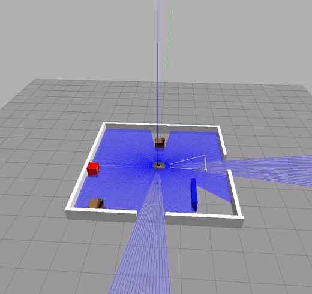
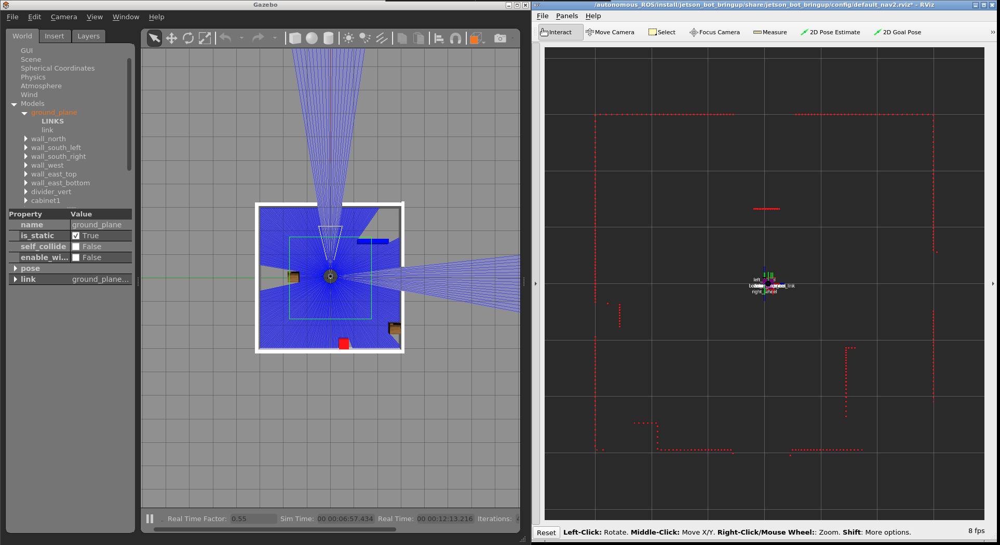
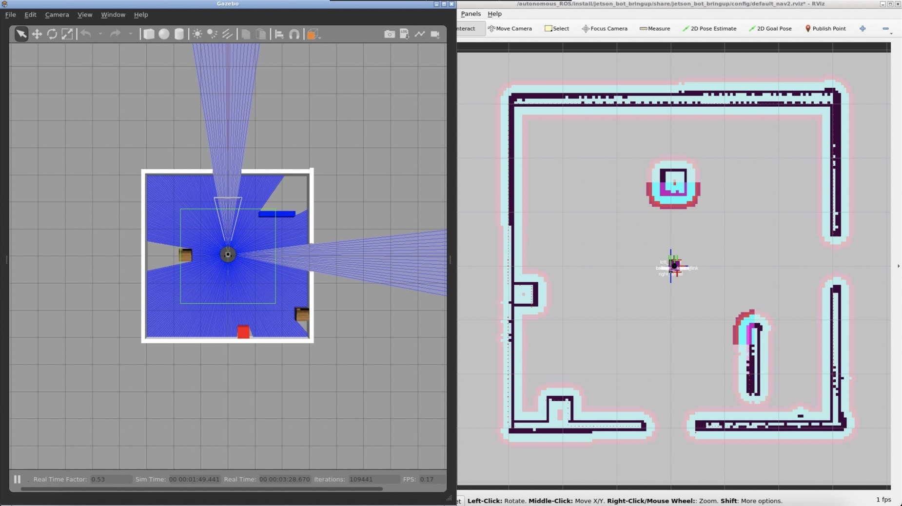
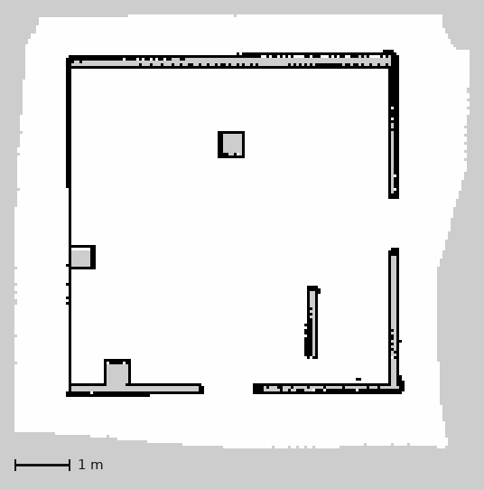
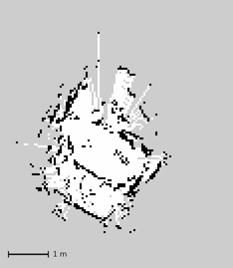
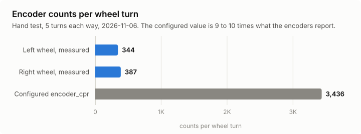
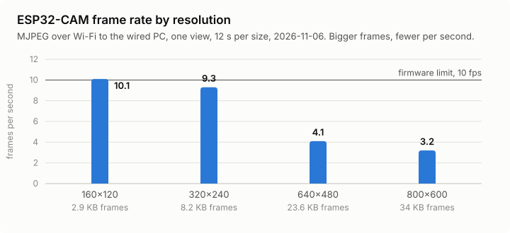

# Experiments and Results

What was tested, on what, and what it showed. Simulation work ran in Docker on a Mac in June 2026. Hardware work ran on the robot's Jetson Xavier NX under ROS 2 Humble from August to November 2026. Day-by-day detail is in [SESSION_LOG.md](../SESSION_LOG.md), and open problems are on the status board in [PROJECT_ANALYSIS.md](../PROJECT_ANALYSIS.md).

## At a Glance

| # | Experiment | Where | When | Outcome |
| :- | :--- | :--- | :--- | :--- |
| 1 | [SLAM and Nav2 in Gazebo](#1-simulation-mapping-and-navigation-in-gazebo) | Simulation | 2026-06 | Map built and goals reached with fused odometry |
| 2 | [Port to ROS 2 Humble](#2-port-to-ros-2-humble-on-the-xavier-nx) | Xavier NX | 2026-08 to 11 | Stack builds and runs in Docker on the robot |
| 3 | [Lidar and SLAM on the robot](#3-lidar-and-slam-on-the-real-robot) | Robot | 2026-08-21, 11-05 | 6.46 Hz scans, `slam_toolbox` builds a map |
| 4 | [ESP32-S3 telemetry](#4-esp32-s3-telemetry-and-the-tf-chain) | Robot | 2026-11-05 | Encoders and IMU at 50 Hz, full TF chain |
| 5 | [Wheel encoder hand test](#5-wheel-encoder-hand-test) | Robot | 2026-11-06 | Found a 9 to 10× scale error and missing direction before the first drive |
| 6 | [IMU at rest](#6-imu-at-rest) | Robot | 2026-11-05 | Gyro bias of 1.4°/s measured, calibration pending |
| 7 | [ESP32-CAM video over Wi-Fi](#7-esp32-cam-video-over-wi-fi) | Camera | 2026-11-05 to 06 | 10 fps at 320×240, firmware fixes tested on hardware |

---

## 1. Simulation: Mapping and Navigation in Gazebo

**Goal:** Prove the full stack (URDF, `slam_toolbox`, AMCL, Nav2, Web UI) on a digital twin before touching the hardware.

**Setup:** Gazebo Classic with the `lab_small_light` world, ROS 2 Foxy in Docker on macOS, RViz over VNC. The robot model uses the chassis measurements from the 2026-06-07 hardware audit (wheel radius 0.034 m, separation 0.212 m, chassis 19.4 × 17.8 × 9.7 cm, lidar 0.064 m ahead of the axle and 0.217 m above the floor).

  
   
  <em>The robot driving in the Gazebo lab world, lidar rays in blue</em>

| Mapping (Gazebo + RViz scan) | Navigation (Nav2 costmap) |
| :---: | :---: |
|  |  |

  
   
  <em>Occupancy grid of the simulated lab, used by AMCL and Nav2 (<code>src/jetson_bot_bringup/worlds/lab_map_v2.pgm</code>)</em>

**Result:** Mapping and autonomous goals worked in simulation with EKF-fused odometry (`/odom_filtered`). The simulation ran at a real-time factor of about 0.55 in Docker on the Mac. A later code review found that in simulation both the diff-drive controller and the EKF publish the `odom → base_footprint` transform, which should be fixed before comparing odometry numbers.

**Lessons, recorded in [AGENTS.md](../../AGENTS.md):**
- The robot looked stuck until the URDF put `base_footprint` at the floor and the model spawned 6 cm up. The wheels had been under the ground plane.
- Lowering contact stiffness to speed up physics let overlapping geometry push the robot around, so the geometry had to be fixed first.
- Inflation `cost_scaling_factor` sets how fast cost falls away from walls. Low values make walls look thick, and both Nav2 configs settled on 3.5.

---

## 2. Port to ROS 2 Humble on the Xavier NX

**Goal:** Move from the original Jetson Nano with native Foxy to a Jetson Xavier NX running ROS 2 Humble.

**What changed:**
- **Container:** `Dockerfile.humble` builds `auto_ros:humble` (Ubuntu 22.04). The host stays on L4T R35.6 (Ubuntu 20.04), so Docker is what makes Humble possible on this board.
- **Launch:** `main.launch.py` adapts per distro: `spawner.py` becomes `spawner`, `slam_toolbox` takes `slam_params_file`, and Nav2 loads `nav2_params_humble.yaml`.
- **Serial ports:** The ESP32-S3 and the lidar are found by USB ID, because `ttyACM` numbers change when the ESP32 resets.

**Limits found:**
- **Gazebo:** Gazebo Classic has no Humble packages for arm64, so simulation needs an amd64 host. The robot itself runs hardware mode only.
- **Camera:** It turned out to be an ESP32-CAM on Wi-Fi, not the CSI Pi Camera in the old docs, so the kernel's `imx219` errors were expected.

---

## 3. Lidar and SLAM on the Real Robot

**Setup:** RPLidar A1 on the Xavier NX's USB (CP2102 adapter), `rplidar_ros` and `slam_toolbox` in the Humble container.

| Measure | Value |
| :--- | :--- |
| Lidar health | OK (firmware 1.29, hardware rev 7) |
| `/scan` rate | 6.46 Hz, 360 points per scan |
| Valid points | 40%, most of the rest within 30 cm, so something on the chassis is in the beam |

  
   
  <em>Map saved by the robot on 2026-08-21 (<code>maps/lab_map_v2.pgm</code>)</em>

**Result:** `slam_toolbox` builds maps from the real lidar. The August map is smeared, which fits the encoder problems found in experiment 5, since odometry was reporting about a tenth of the real distance at the time. A full mapping run with calibrated odometry is still to come.

---

## 4. ESP32-S3 Telemetry and the TF Chain

**Setup:** ESP32-S3 on its native USB socket (`303a:1001`), the Python bridge `diffdrive_node`, `imu_bridge_node`, the Madgwick filter and the EKF. No motor commands were sent.

| Topic | Rate | Source |
| :--- | :--- | :--- |
| Encoder `e` lines | 50 Hz | ESP32-S3 serial |
| IMU `i` lines | 50 Hz | ESP32-S3 serial |
| `/odom` | 50 Hz | `diffdrive_node` |
| `/joint_states` | 50 Hz | `diffdrive_node` |
| `/imu/data` | 50 Hz | Madgwick filter |
| `/odom_filtered` | 30 Hz | `robot_localization` EKF |

**Result:** The full TF chain `map → odom → base_footprint → base_link → sensors` was present, and `slam_toolbox` built a map with it.

**Fix found here:** On startup the bridge treated the ESP32's accumulated counts as motion, which put `/odom` at (-3.13, -2.72). It now takes its first reading as a baseline, and `/odom` starts at zero (2026-11-05 23:15 in the session log).

---

## 5. Wheel Encoder Hand Test

**Goal:** Check encoder scale and direction before the first powered drive.

**Method:** With the robot still, each wheel was turned by hand 5 times forward and 5 times back, left first, while the counts were logged once a second.

  <picture>
    <source media="(prefers-color-scheme: dark)" srcset="../../assets/results/encoder_counts_dark.svg">
    
  </picture>

| Wheel | Count change over 10 turns | Counts per turn | Configured |
| :--- | ---: | ---: | ---: |
| Left | -3,437 | 344 | 3,436 |
| Right | +3,866 | 387 | 3,436 |

**Findings:**
- **Scale:** The encoders report 9 to 10 times fewer counts per turn than the bridge is configured for, so odometry would show about a tenth of the real distance. The left wheel's 10-turn total is almost exactly 3,436, so that value may have been measured over 10 turns and recorded as one.
- **Direction:** Neither count reversed. The left count only fell and the right only rose, which is what the firmware does when the encoder's B channel reads high, as an unconnected input with a pull-up would. Every motion would then read as backward. This holds if the second five turns really were backward.

**Next:** A rebuilt motor firmware (branch `quadrature-speed-control` in [MOTOR-ESP32S3](https://github.com/jakhon37/MOTOR-ESP32S3), not yet on the robot) decodes all four edges of both channels and checks direction. With 4 times as many counts per turn, `encoder_cpr` will be set from a new marked test once it's flashed.

---

## 6. IMU at Rest

**Setup:** MPU6050 on the ESP32-S3's I2C bus (SDA GPIO 1, SCL GPIO 21), read at 50 Hz and sent over the same serial link as the encoders.

| Measure | Value |
| :--- | :--- |
| Acceleration magnitude | 9.77 m/s² |
| Gyro z at rest | about 0.024 rad/s (1.4°/s) |
| `/odom_filtered` yaw drift | about 0.1°/s |

**Result:** The IMU works, but its gyro bias needs calibrating before it helps the EKF. Gyro values also arrive with only 2 decimals, in steps of 0.01 rad/s, which limits how finely the bias can be estimated.

**Found in code review:** The Madgwick filter runs in `stateless` mode without a magnetometer, so its orientation has no real heading, yet the EKF fuses its yaw. The bridge also publishes `/odom` with zero covariance, which the EKF treats as near-perfect. Both are next to check in a drive test.

---

## 7. ESP32-CAM Video over Wi-Fi

**Setup:** AI-Thinker ESP32-CAM (OV2640) streaming MJPEG over Wi-Fi from its own firmware, [myESP32CAM-BLACKBOX](https://github.com/jakhon37/myESP32CAM-BLACKBOX). It isn't connected to ROS in this repo yet.

**Firmware changes:** Branch `wifi-reliability` of that repo, flashed and tested on the camera:

| Change | How it was checked | Result |
| :--- | :--- | :--- |
| Turn off Wi-Fi power saving | Idle ping, 15 minutes apart | 290 to 330 ms down to about 13 ms (median) |
| Retry home Wi-Fi every 30 s while on the fallback hotspot | Wrong network name, then a 1 ms boot timeout | Hotspot stays up while retries fail. A successful retry joins in about 1 s and turns the hotspot off |
| Restart if the sensor fails to start | Not tested on hardware yet | Previously it halted with no network |

  <picture>
    <source media="(prefers-color-scheme: dark)" srcset="../../assets/results/camera_fps_dark.svg">
    
  </picture>

| Resolution | Frame size | From the wired PC | From the Jetson |
| :--- | ---: | ---: | ---: |
| 160×120 | 2.9 KB | 10.1 fps | Not measured |
| 320×240 | 8.2 KB | 9.3 fps | 9.8 fps |
| 640×480 | 23.6 KB | 4.1 fps | 2.9 fps |
| 800×600 | 34 KB | 3.2 fps | Not measured |

**Findings:**
- **Throughput:** 320×240 runs close to the firmware's 10 fps limit. At 640×480, frame rate falls as frames get bigger, and a 20-minute run averaged about 6 fps.
- **Stalls:** Pauses of up to 3 s at 640×480 aren't explained by bandwidth, and their cause is unknown.
- **Open problems:** One boot gave no frames at all at 640×480 or larger for 20 minutes, while smaller sizes worked. Its cause is unknown. A slowdown the night before, when an 18 KB page downloaded at about 5 KB/s, cleared after the camera moved to a phone charger, but power, position and time of day changed together.
- **Design limits for the ROS node:** The firmware serves one request at a time and its frames carry no timestamps. `/capture` also saves every photo to the SD card, so a ROS node should be the stream's only client, stamp frames on arrival, and avoid polling `/capture`.

---

## What's Next

1. **First drive:** Flash the rebuilt motor firmware, then a first drive with the wheels off the ground, following its checklist.
2. **Calibration:** Set `encoder_cpr` from a marked test, calibrate the IMU gyro bias, and check that the front of the scan matches the front of the robot.
3. **Hardware mapping run:** A full mapping run and a Nav2 goal on the real robot.
4. **Camera in ROS:** A node that reads the ESP32-CAM stream, for camera-based docking, which is developed in a separate project.
