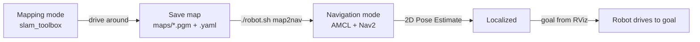
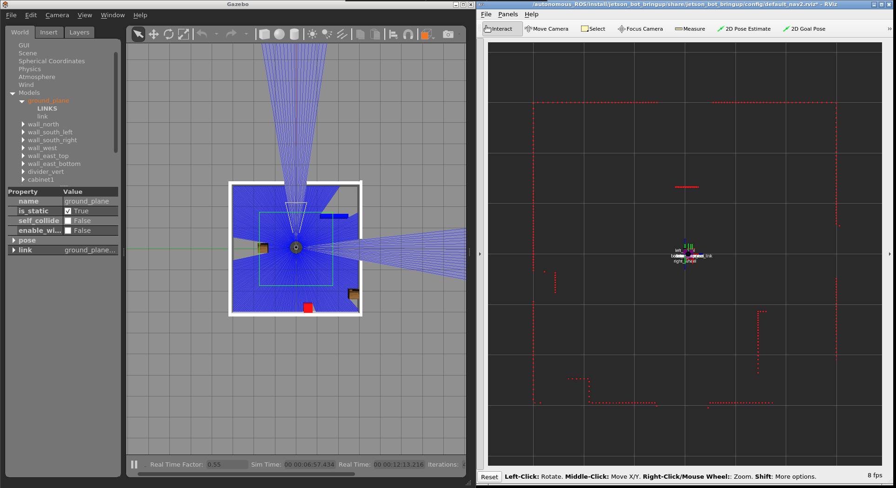
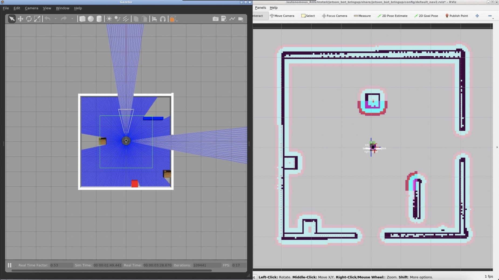

# Mapping and Navigation

The workflow is the same in simulation and on the robot: build a map with `slam_toolbox`, save it, then localize with AMCL and send goals to Nav2.



## 1. Build a Map

1. Start mapping: `./robot.sh sim` in simulation, or `./robot.sh robot` on the robot.
2. Drive slowly around the space with the Web UI's teleop pad at <http://localhost:8000>. Overlapping loops help `slam_toolbox` close the map.
3. Watch the map grow in RViz (VNC at `localhost:5900`) or on the dashboard's map view.
4. Save it from the dashboard, or from the command line:

```bash
./robot.sh shell "ros2 run nav2_map_server map_saver_cli -f /autonomous_ROS/maps/current_map"
```

<p align="center">
  
  <br>
  <em>Mapping in simulation: Gazebo on the left, the scan in RViz on the right</em>
</p>

## 2. Navigate

1. Set the map name in `src/jetson_bot_bringup/config/unified_robot_config.yaml`, then `./robot.sh build`.
2. Switch modes with `./robot.sh map2nav`, which saves the map first if you were mapping, or start with `./robot.sh nav`. Both run on the robot with the committed config. In simulation, use `./robot.sh sim mode:=navigation`. It loads the map named in the YAML, which is `lab_map_v2` from the robot, so for the simulated room load `src/jetson_bot_bringup/worlds/lab_small_light.yaml` through the `/map_server/load_map` service.
3. AMCL assumes the robot starts at the map origin. If it doesn't, give it the starting pose with **2D Pose Estimate** in RViz. Until AMCL has a pose, RViz reports that the `map` frame doesn't exist.
4. Send a goal with **2D Goal Pose** in RViz. Nav2 plans globally, follows with the DWB local planner and runs recovery behaviours if it gets stuck. The dashboard's goal button publishes the same `/goal_pose` message as that tool, and its cancel button calls Nav2's cancel service. Both were checked against Nav2 in simulation on 2026-11-09.

<p align="center">
  
  <br>
  <em>Navigation in simulation: Nav2's costmap with inflated walls</em>
</p>

## Tips for the Real Robot

- **Odometry:** Nav2 uses the EKF's `/odom_filtered`, and `slam_toolbox` takes odometry from the `odom → base_footprint` transform, which the EKF publishes on the robot. Wheel odometry isn't calibrated yet, see [RESULTS.md](../experiments/RESULTS.md#5-wheel-encoder-hand-test).
- **Speed:** Drive slowly while mapping. The lidar gives about 6.5 scans a second.
- **Costmap tuning:** Inflation `cost_scaling_factor` sets how fast cost falls away from walls. Low values make walls look thick, and both Nav2 configs use 3.5.
- **Footprint:** Nav2 treats the robot as a 0.15 m circle, but the chassis corners reach 0.18 m from its centre, so leave extra room in tight spaces.
